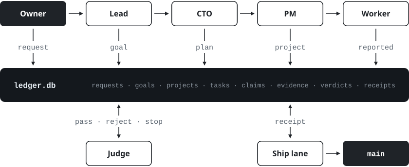

<p align="center">
  <picture>
    <source media="(prefers-color-scheme: dark)" srcset="assets/readme/wordmark-dark.svg">
    
  </picture>
</p>

<p align="center">
  <b>Multi-agent orchestration harness</b><br>
  에이전트는 여럿, 장부는 하나.<br>
  자기 일은 자기가 판정하지 않는다.
</p>

<p align="center">
  <a href="LICENSE"><picture><source media="(prefers-color-scheme: dark)" srcset="https://img.shields.io/badge/license-Apache--2.0-e6edf3?style=flat-square&labelColor=30363d"></picture></a>
  <a href="pyproject.toml"><picture><source media="(prefers-color-scheme: dark)" srcset="https://img.shields.io/badge/python-%E2%89%A53.11-e6edf3?style=flat-square&labelColor=30363d"></picture></a>
  <a href="#실행해-보기"><picture><source media="(prefers-color-scheme: dark)" srcset="https://img.shields.io/badge/platform-macOS%20%7C%20Linux-e6edf3?style=flat-square&labelColor=30363d"></picture></a>
  <a href="#상태"><picture><source media="(prefers-color-scheme: dark)" srcset="https://img.shields.io/badge/status-showcase-e6edf3?style=flat-square&labelColor=30363d"></picture></a>
  <!-- badges:ci-release -->
</p>

<p align="center">
  <a href="README.md">English</a> · <a href="docs/design.ko.md">설계</a> · <a href="#실행해-보기">데모 실행</a>
</p>

<p align="center">
  <picture>
    <source media="(max-width: 700px)" srcset="assets/readme/ledger-narrow.svg">
    <source media="(min-width: 768px) and (max-width: 1080px)" srcset="assets/readme/ledger-narrow.svg">
    
  </picture>
</p>

<p align="center">
  <sub>지어낸 작업 하나의 장부다. 판정자가 증거 빠진 첫 주장을 반려하고 두 번째를 통과시키면, 배포 레인이 영수증을 남긴다.<br>
  행은 <a href="docs/demo/transcript.txt">docs/demo/transcript.txt</a>에서 가져왔고, 그림은 <a href="assets/readme/render.py">assets/readme/render.py</a>가 그린다.</sub>
</p>

한 사람이 여러 AI 에이전트에게 일을 맡기다 보면, 무엇이 정해졌고 무엇이 끝났으며 무엇이 실제로 확인됐는지 금방 알 수 없게 된다.

Artemis는 이 세 가지를 따로 기록해 두는 하네스다. 요청과 결정, 완료 주장과 증거는 모두 장부라는 데이터베이스 한 곳에 들어가고, 채팅과 대시보드는 장부에 있는 것을 보여 줄 뿐이다. 완료 주장은 그 일을 하지 않은 판정자가 판정한다. 모든 변경은 배포 레인 하나를 거쳐 main 브랜치에 들어가고, 들어갈 때마다 영수증이 남는다.

코딩 에이전트 하나를 위한 설정 묶음(한 세션에서 쓰는 스킬과 지침 파일)이 아니다. 여러 에이전트를 둘러싼 조직, 즉 누가 결정하고, 상태를 어디에 두고, 누가 결과를 확인하고, 변경이 어떻게 반영되는지를 다룬다.

## 역할

<p align="center">
  <picture>
    <source media="(max-width: 700px)" srcset="assets/readme/roles-narrow.svg">
    <source media="(min-width: 768px) and (max-width: 1080px)" srcset="assets/readme/roles-narrow.svg">
    <source media="(prefers-color-scheme: dark)" srcset="assets/readme/roles-dark.svg">
    
  </picture>
</p>

에이전트는 저마다 범위가 글로 정해진 역할 하나를 맡고, 받은 일을 더 작게 나눠 다음 역할에 넘긴다. 오너가 요청하면 리드가 무엇을 왜 할지 정하고, CTO가 어떻게 할지 정한다. PM은 프로젝트 하나를 맡고, 워커는 작업 하나를 한다. 누구든 자기 단계를 장부에 적은 다음에 일을 넘긴다.

이 사슬 밖에 판정자가 있다. 코드에서는 CQO라고 부른다. 판정자는 일을 하지 않는다. 완료 주장과 증거를 읽고 통과, 반려, 정지 가운데 하나로 판정한다. 반려할 때는 빠진 것을 적고, 판정할 수 없을 때는 정지한다.

코드: [roles.py](src/harness/roles.py) · [judge.py](src/harness/judge.py) · [ledger.py](src/harness/ledger.py)

## 배포 레인

누가 만든 변경이든 이 길 하나로만 main에 들어간다.

<p align="center">
  <picture>
    <source media="(max-width: 700px)" srcset="assets/readme/ship-lane-narrow.svg">
    <source media="(min-width: 768px) and (max-width: 1080px)" srcset="assets/readme/ship-lane-narrow.svg">
    <source media="(prefers-color-scheme: dark)" srcset="assets/readme/ship-lane-dark.svg">
    
  </picture>
</p>

브랜치는 커밋 하나에 고정된 채로 들어온다. 사람이 정지를 걸어 두었으면 사람이 풀 때까지 아무것도 실행되지 않는다. 정지가 없으면 `ship.toml`에 적힌 검사가 일회용 작업트리에서 돈다. 검사가 실패하면 main은 그대로 두고 red 영수증을 남긴다. 검사를 통과하면 main을 fast-forward하고 영수증을 applied로 적는다. 그사이 main이 앞서 나갔으면 영수증은 stale이 되고, 그 변경은 새 커밋으로 다시 들어와야 한다.

코드: [ship.py](src/harness/ship.py) · [test_ship.py](tests/test_ship.py)

## 원칙

- **상태는 장부에만 있다.** 채팅 답변과 대시보드, 파일은 장부의 행을 보여 줄 뿐이다. 장부에 적지 않은 사실은 세션이 끝나면 사라진다.
- **판정하는 쪽과 일하는 쪽은 다르다.** 증거란 출력과 함께 남긴 명령이거나 직접 열어 볼 수 있는 결과물이다. 증거 없는 주장에는 "보고됨"이라고 적는다.
- **사람이 건 정지는 모든 자동화보다 앞선다.** 타이머와 재시도, 대기열, 장애 복구는 움직이기 전에 정지가 걸렸는지부터 본다. 정지는 사람만 풀 수 있다.
- **세 가지 일은 오너가 승낙해야 한다.** 돈을 쓰는 일, 되돌릴 수 없는 삭제, 오너 이름으로 말하는 일이다. 나머지는 먼저 하고 나서 알린다.
- **절차는 필요할 때 읽는다.** 역할은 절차마다 한 줄짜리 안내만 지니고, 그 순간이 오면 전문을 연다. 데모의 절차는 [examples/runbooks](examples/runbooks)에 있다.
- **증상이 아니라 설계를 고친다.** 무언가 실패하면 그 실패를 허용한 설계를 바꾼다. 실패가 드러난 자리에 덧대지 않는다.

[docs/design.ko.md](docs/design.ko.md)에 원칙마다 설명이 있고, 그 원칙이 `src/harness/`의 어느 모듈에 구현돼 있는지도 적혀 있다.

## 실행해 보기

이 페이지 맨 위의 장부가 바로 이 실행의 결과다. 데모는 지어낸 작업 하나를 역할과 판정자, 배포 레인에 차례로 통과시키고, 로컬 장부에는 지어낸 데이터만 들어간다. 전체 출력은 [docs/demo/transcript.txt](docs/demo/transcript.txt)에 있다.

Python 3.11 이상과 Git이 필요하고, macOS나 Linux에서 돈다.

<!-- quickstart:begin -->
Python 3.11 이상, Git, POSIX 셸이 필요하다.

### 설치

Artemis를 클론한 디렉터리에서 다음 명령을 실행한다.

```sh
python3 -m venv .venv
. .venv/bin/activate
python -m pip install .
```

### 프로젝트 실행

가상 환경을 활성화한 채 빈 디렉터리에서 아래 명령을 실행한다. 새 Git 저장소에 가상의 텃밭 목록을 만든다.

```sh
set -eu
mkdir garden-list
cd garden-list
git init -q -b main
git config user.name "Garden Example"
git config user.email garden-example
git config commit.gpgsign false
printf '.harness/\n' > .gitignore
harness init

printf 'print("basil")\n' > garden.py
git add .gitignore harness.toml garden.py
git commit -qm "Start a garden list"

request=$(harness request "Make the garden list readable by scripts")
goal=$(harness goal "$request" "Print the list as a JSON array")
harness plan "$goal" "Use the standard JSON library and check the output"
project=$(harness project "$goal" "Garden list")
task=$(harness assign "$project" "Print JSON" \
  --criterion 'Source=file:garden.py' --criterion 'JSON output=cmd:python check.py')
approval=$(harness request-action --task "$task" --kind 'send as owner' "Publish a sample note")

git switch -qc json-list
cat > garden.py <<'EOF'
import json

print(json.dumps(["basil"]))
EOF
cat > check.py <<'EOF'
import json
import subprocess
import sys

output = subprocess.check_output([sys.executable, "garden.py"], text=True)
assert json.loads(output) == ["basil"]
print("JSON check passed")
EOF
git add garden.py check.py
git commit -qm "Print the list as JSON"
commit=$(git rev-parse HEAD)

harness stop "Pause before submitting"
if harness submit --task "$task" --commit "$commit" --claim "Ready"; then exit 1; else test "$?" -eq 1; fi
harness resume "Continue the example"

harness submit --task "$task" --commit "$commit" --claim "JSON is ready" --evidence 'file:garden.py'
if harness judge --task "$task"; then exit 1; else test "$?" -eq 3; fi
harness submit --task "$task" --commit "$commit" --claim "JSON check recorded" \
  --evidence 'file:garden.py' --evidence 'cmd:python check.py'
harness judge --task "$task"

git switch -q main
harness ship --task "$task" --branch json-list
test "$(git rev-parse main)" = "$commit"
if harness action --approval "$approval"; then exit 1; else test "$?" -eq 1; fi
harness approve --approval "$approval"
harness action --approval "$approval"
harness show --task "$task"
```

정지 중에는 제출이 막힌다. 재개하면 명령 증거가 빠진 제출을 판정자가 반려한다. 증거를 보완하면 판정이 통과하고 배포 영수증이 남는다. 게시 요청은 승인을 기다리며 승인 뒤 게시를 모의 실행한다. 타임라인과 영수증은 `garden-list/.harness/ledger.db`에 저장한다. 텃밭 프로젝트에서 `harness show`로 다시 볼 수 있다.

자기 저장소에서는 루트에서 `harness init`을 실행하고 `harness.toml`에서 `ship.checks`와 역할별 런북 경로를 설정한다. `.harness/`는 Git에 넣지 않고, 배포하기 전에 작업 트리가 깨끗한 `main`을 체크아웃한다. 증거 수집과 검사 명령은 일회용 Git 작업 트리에서 현재 프로세스 권한으로 실행한다. 신뢰할 수 있는 명령과 커밋을 사용한다. 명령마다 역할이 정해져 있으므로 로컬 작업자는 모든 역할을 실행할 수 있다.

로컬 워커를 연결하려면 `[roles.worker]` 아래의 `run` 주석을 풀고 실행할 명령을 지정한다. `harness run --task N --commit SHA`는 런북, 작업 번호, 커밋, 완료 기준을 표준 입력으로 전달한다. 표준 출력을 완료 주장으로 기록한다. 검증에 쓸 증거는 `--evidence`로 수집한다. `harness runbook worker`로 설정된 지침을 읽는다.

종료 코드는 성공 시 0, 워크플로 또는 로컬 작업 오류 시 1, 명령 문법이 잘못되면 2다. 판정 반려는 3, 정지는 4다. 검사에 실패하거나 후보 커밋이 `main`과 갈라졌으면 배포 명령은 5를 반환한다.
<!-- quickstart:end -->

## 상태

이 저장소는 쇼케이스다. 설계 문서와 로컬 데모가 들어 있고, 데모에서는 실제 에이전트 대신 스크립트로 짠 역할이 움직인다. 사람이 필요한 단계에서는 시스템이 기다린다. 데모는 macOS와 Linux에서 돈다. Windows는 아직 지원하지 않고, 설치형 릴리스도 아직 나오지 않았다.

이 쇼케이스가 참고한 오픈소스 프로젝트는 [NOTICES.md](NOTICES.md)에 있다.

<p align="center">
  <sub>Apache-2.0 · <a href="LICENSE">LICENSE</a></sub>
</p>
