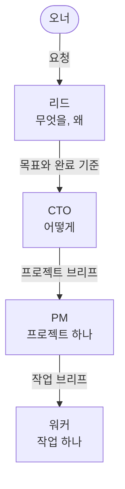
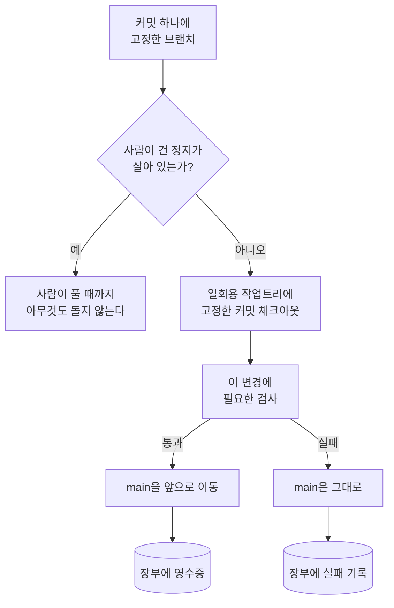

# Artemis

[English](README.md) · 한국어

한 사람이 여러 AI 에이전트에게 일을 맡기다 보면, 무엇이 정해졌고 무엇이 끝났으며 무엇이 실제로 확인됐는지 금방 알 수 없게 된다.

Artemis는 이 세 가지를 따로 기록해 두는 하네스다. 에이전트는 저마다 범위가 글로 정해진 역할 하나를 맡고, 받은 일을 더 작게 나눠 다음 역할에 넘긴다. 요청과 결정, 완료 주장과 증거는 모두 장부라는 데이터베이스 한 곳에 들어가고, 채팅과 대시보드는 장부에 있는 것을 보여 줄 뿐이다. 완료 주장은 그 일을 하지 않은 판정자가 판정한다. 모든 변경은 배포 레인 하나를 거쳐 main 브랜치에 들어가고, 들어갈 때마다 영수증이 남는다.

## 역할



이 사슬 바깥에 판정자가 있다. 코드에서는 CQO라고 부른다. 판정자는 작업에 손대지 않고, 증거가 붙은 완료 주장을 읽어 세 가지 가운데 하나로 판정한다. 통과, 빈틈을 적은 반려, 그리고 판정할 수 없을 때의 정지다.

## 작업 하나가 끝나기까지

데모는 가상의 할 일 CLI 변경 과정을 SQLite에 기록한다.

1. 오너가 스크립트로 읽을 수 있는 출력을 요청한다. 리드는 목표를, CTO는 구현 방식을 기록하고 PM은 JSON 옵션 작업을 배정한다.
2. 워커가 커밋과 파일 해시를 제출한다. 판정자는 테스트 결과가 빠져 반려한다.
3. 워커가 같은 커밋에 테스트 명령과 출력을 붙여 다시 제출한다. 판정자가 통과시킨다.
4. 배포 레인이 그 커밋을 검사하고 main을 앞으로 옮긴 뒤 영수증을 기록한다.

## 배포 레인

누가 만든 변경이든 main에는 이 길 하나로만 들어간다.



## 원칙

- **상태는 장부에만 있다.** 채팅 답장, 대시보드, 파일은 장부의 행을 보여 줄 뿐이다. 장부에 적히지 않은 사실은 세션이 끝나면 사라진다.
- **배포 레인은 하나다.** 모든 변경은 버리는 작업트리에서 검사를 거쳐 영수증과 함께 들어가거나, 들어가지 않는다.
- **판정자는 일한 쪽이 아니다.** 증명으로 치는 것은 실행한 명령과 그 출력, 또는 직접 열어 볼 수 있는 결과물이다. 증명이 없는 주장에는 "보고됨"이 붙는다.
- **사람이 건 정지는 어떤 자동화보다 세다.** 타이머, 재시도, 대기열, 장애 복구는 움직이기 전에 정지가 있는지 보고, 정지를 풀 수 있는 것은 사람뿐이다.
- **오너의 승낙이 필요한 일은 세 종류다.** 돈을 쓰는 일, 되살릴 수 없게 지우는 일, 오너의 이름으로 말하는 일이다. 나머지는 먼저 진행하고 나중에 알린다.
- **절차는 필요할 때 읽는다.** 역할은 절차마다 한 줄짜리 안내만 지니고, 그 순간이 오면 전문을 연다.
- **증상이 아니라 설계를 고친다.** 무언가 실패하면 그 실패를 허용한 설계를 바꾼다. 실패가 드러난 자리에 무언가를 덧대지 않는다.

## 실행해 보기


전체 출력: [docs/demo/transcript.txt](docs/demo/transcript.txt)

```sh
python3 -m venv .venv && . .venv/bin/activate && pip install -e . && harness demo
```

데모는 지어낸 작업 하나를 역할, 판정자, 배포 레인에 차례로 통과시킨다. 장부는 로컬에 만들고, 그 안에는 지어낸 데이터만 들어간다.

## 설계

[docs/design.ko.md](docs/design.ko.md)에 각 원칙을 설명하고, `src/harness/`의 어느 모듈에 들어 있는지 적었다.

## 여기에 없는 것

로컬 데모는 미리 정한 역할별 동작을 실행한다. 사람이 필요한 단계에서는 시스템이 기다린다.

## 상태

설계 문서와 로컬에서 실행할 수 있는 데모를 담았다.

이 전시에 참고한 오픈소스 프로젝트는 [NOTICES.md](NOTICES.md)에 적었다.
