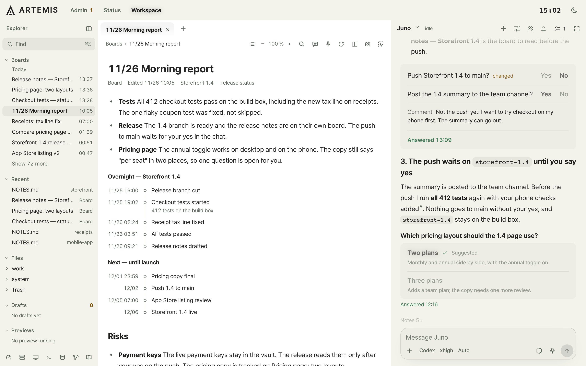
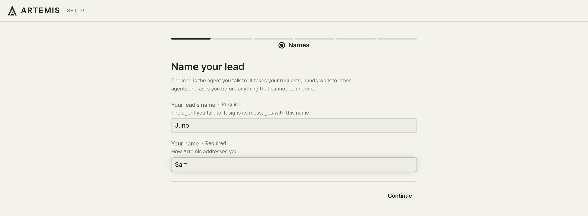
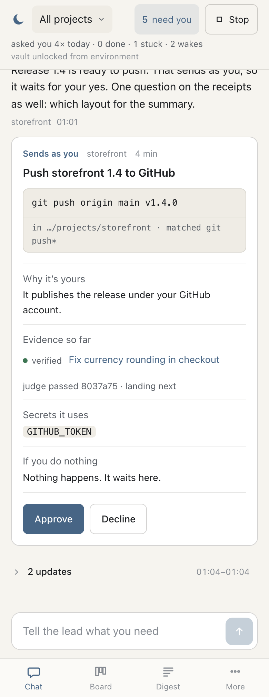

<p align="center">
  <picture>
    <source media="(prefers-color-scheme: dark)" srcset="assets/readme/logo-dark.svg">
    
  </picture>
</p>

<p align="center">
  <b>팀 하나를 거느린 유능한 엔지니어 한 명과 일하는 경험.</b><br>
  Artemis는 내 컴퓨터나 늘 켜 둔 서버에서 직접 돌리는(셀프 호스팅) AI 에이전트의 집이에요. 데스크톱이든 폰이든 어느 브라우저에서나 리드 한 명과 대화하면, Claude Code, Codex, Gemini CLI, OpenCode 같은 여러 회사의 AI가 내 규칙 안에서 내 컴퓨터로 일을 하고, 내가 정해야 할 일만 나에게 물어요.
</p>

<p align="center">
  <a href="LICENSE"><picture><source media="(prefers-color-scheme: dark)" srcset="https://img.shields.io/badge/license-Apache--2.0-e6edf3?style=flat-square&labelColor=30363d"></picture></a>
  <a href="pyproject.toml"><picture><source media="(prefers-color-scheme: dark)" srcset="https://img.shields.io/badge/python-%E2%89%A53.11-e6edf3?style=flat-square&labelColor=30363d"></picture></a>
  <a href="#1분-만에-써-보기"><picture><source media="(prefers-color-scheme: dark)" srcset="https://img.shields.io/badge/platform-macOS%20%7C%20Linux%20%7C%20Windows-e6edf3?style=flat-square&labelColor=30363d"></picture></a>
  <a href="#현재-상태"><picture><source media="(prefers-color-scheme: dark)" srcset="https://img.shields.io/badge/status-early%20release-e6edf3?style=flat-square&labelColor=30363d"></picture></a>
  <a href="https://github.com/ianlyoo/artemis/actions"><picture><source media="(prefers-color-scheme: dark)" srcset="https://img.shields.io/github/actions/workflow/status/ianlyoo/artemis/ci.yml?style=flat-square&labelColor=30363d&color=e6edf3&label=CI&branch=main"></picture></a>
</p>

<p align="center">
  <a href="README.md">English</a> · <a href="https://youtu.be/Yxw6hL3c57o">2분 시연 영상</a> · <a href="docs/design.ko.md">설계</a> · <a href="#1분-만에-써-보기">써 보기</a>
</p>

채팅 비서는 자기 샌드박스 밖으로 못 나가고, 코딩 세션은 창을 닫으면 끝나요. 에이전트 여러 개를 직접 돌리면 결국 내가 병목이 돼요. 프로젝트마다 어디까지 왔는지 머리로 기억하고, 키를 프롬프트에 붙여 넣고, 읽지도 않은 걸 승인하게 되죠.

Artemis는 내가 자리를 비워도 일이 계속되는 '홈'이에요. 내 컴퓨터의 프로세스 하나가 모든 프로젝트를 장부 하나에 담아요. 그래서 대화하는 리드는 프로젝트마다 어디까지 왔는지, 무엇을 배웠는지, 무엇이 나를 기다리는지 알아요. 리드를 다른 회사 모델로 바꿔도 마찬가지예요. 작업자는 Artemis의 도구로만 내 컴퓨터를 건드려요. 관문 하나가 정지 여부, 등록한 폴더, 내 규칙, 금고를 확인하고 무엇을 했는지 기록해요. 나에게 묻는 일은 세 가지뿐이에요. 돈이 나가는 일, 되돌릴 수 없는 삭제, 나 대신 보내는 일. 나머지는 줄마다 근거가 붙은 요약으로 와요.

<p align="center">
  <picture>
    <source media="(prefers-color-scheme: dark)" srcset="assets/readme/app-board-dark.png">
    
  </picture>
  <br><sub>만든 사람이 여러 대의 기기에서 쓰는 Artemis를 찍고, 이름과 글은 모두 지어낸 것으로 바꿨어요. 다른 기기와 계정을 다루는 패널은 그 환경에서만 보이고 0.4에는 없어요.</sub>
</p>

<p align="center">
  <a href="https://youtu.be/Yxw6hL3c57o"><strong>2분 시연 영상 보기 (YouTube) ↗</strong></a>
</p>

## 무엇을 하나요

| | |
|---|---|
| **내 컴퓨터에서 진짜 일을 끝까지** | 프로젝트는 Git 저장소일 수도, 아무 폴더일 수도 있어요. 작업자는 거기서 파일을 읽고, 쓰고, 옮기고, 프로그램을 실행해요. 예약한 일은 채팅을 닫아 둬도 돌아요. 작업자가 아닌 판정자가 결과를 확인해요. 종료 코드, 파일 해시, 행 수 같은 것으로요. `artemis undo`로 파일을 원래대로 돌려요. |
| **비밀값은 지키고, 결정은 내가** | 암호화 금고가 키를 이름으로 보관해요. 웹사이트용 키는 Artemis만, 그 웹사이트로만 보내요. 돈이 나가는 일, 되돌릴 수 없는 삭제, 나 대신 보내는 일은 카드로 내 답을 기다려요. 코드는 반영 경로 하나로만 브랜치에 들어가요. `artemis stop` 한 번이면 전부 멈춰요. |
| **어느 기기에서나 같은 앱** | PC·맥·폰 브라우저에서 리드와 대화하고, 승인·선택·비밀값 카드에 답하고, 리드가 쓴 보드를 읽고, 에이전트마다 하고 있는 일을 봐요. 처음 열 때 설정에서 리드 이름과 나에게 물어볼 일을 정해요. 폰은 HTTPS로 연결하고 내 컴퓨터에서 확인해 줘야 들어와요. |
| **실수에서 배워요** | 판정에서 떨어진 결과나 내가 고쳐 준 말이 교훈이 돼요. 교훈은 다음 작업 지시를 바꾸거나, 판정자가 돌릴 검사를 더하거나, 어떤 종류의 일을 어느 모델에 맡길지 바꿔요. 언제 배웠고 언제 썼는지 요약에 나와요. 내가 거절한 카드는 새 규칙이 될 수 있지만, 내가 그렇게 하자고 할 때만요. |
| **리드 한 명 뒤의 여러 모델 팀** | Claude Code, Codex, Gemini CLI, OpenCode, OpenAI 호환 API가 나란히 일해요. 일의 종류마다 잘 맞는 모델이 맡고, 검토는 늘 작업한 모델과 다른 회사 모델이 해요. 리드의 기억은 장부라서 대화 도중에 리드 모델을 바꿔도 돼요. |

## 1분 만에 써 보기

<!-- quickstart:begin -->
macOS, Linux, Windows 어디서든 Python 3.11 이상과 Git만 있으면 돼요. 여기까지는 계정이 필요 없어요.

### 설치

```sh
curl -fsSL https://raw.githubusercontent.com/ianlyoo/artemis/main/install.sh | sh
```

Windows에서는 PowerShell에서:

```powershell
irm https://raw.githubusercontent.com/ianlyoo/artemis/main/install.ps1 | iex
```

설치 스크립트는 pipx나 uv가 있으면 그걸 쓰고, 둘 다 없으면 Artemis 전용 가상 환경을 만들어요. 명령 폴더를 새 터미널의 PATH에 넣고(못 넣으면 넣을 줄을 알려 주고), `artemis doctor`로 이 컴퓨터에서 무엇을 돌릴 수 있는지 보여 준 뒤, 마지막 줄에 다시 지우는 명령(`pipx uninstall artemis-harness` 또는 `uv tool uninstall artemis-harness`)을 알려 줘요. 지금 터미널이 `artemis`를 모르면 새 터미널을 여세요.

### 데모 실행

```sh
artemis demo
```

데모는 임시 폴더에 작은 할 일 목록 프로젝트를 만들고 리드에게 한 문장을 줘요. 작업자 셋이 각자 Git 워크트리에서 동시에 일하고, 검사를 통과한 작업만 반영 경로로 들어가요. 네 번째 일은 팀에 릴리스 노트를 올리는 건데, 나 대신 보내는 일이라서 카드가 돼요. 카드에는 정확한 요청, 본문의 해시, 쓰는 키의 이름이 나오고 키 값은 금고에 그대로 있어요. 데모가 나 대신 승인하면 Artemis가 내 컴퓨터 안의 수신기로 한 번 보내고, 요약이 도착한 내용과 승인한 내용을 비교해요. 작업자는 AI 없이 정해진 수정을 하는 모의 작업자이고 그렇다고 표시돼요. 그래서 계정이 필요 없어요.
<!-- quickstart:end -->

## 나의 홈

```sh
artemis serve
```

홈을 켜고 브라우저에 앱을 열어요. 처음 열면 짧은 설정이 차례로 안내해요. 리드와 내 이름을 정하고, 누가 리드를 맡을지 고르고(이 컴퓨터에 로그인된 코딩 에이전트, 또는 키를 금고에 넣는 OpenAI 호환 API), Artemis가 하기 전에 꼭 물어볼 일을 체크하고, 그중 폰에서만 승인할 일을 고르고, 폰을 연결해요. 전부 나중에 설정에서 바꿀 수 있어요.

<p align="center">
  <picture>
    <source media="(prefers-color-scheme: dark)" srcset="assets/readme/app-setup-dark.png">
    
  </picture>
</p>

앱에는 화면이 셋 있어요. **Workspace**는 리드와의 대화 옆에 리드가 만든 보드, 보고서, 파일이 함께 보이는 곳이고, 승인·선택·비밀값 카드도 대화 안에서 바로 답해요. **Admin**은 나를 기다리는 일과 에이전트마다 하고 있는 일을 보여 주고, 오늘을 한 줄로 요약해요(끝낸 일, 물어본 횟수, 막힌 일). **Status**는 요청마다 어떤 목표, 프로젝트, 에이전트로 이어졌는지 따라가 보여 줘요.

홈은 리드, 작업자, 예약, 앱을 돌리고 모든 것을 `~/.artemis`에 둬요(Windows는 `%USERPROFILE%\.artemis`, 옮기려면 `ARTEMIS_HOME`을 지정하세요). 한 폴더에 홈은 하나만 떠요. `artemis serve --background`는 터미널과 떼어서 돌리고, `artemis serve --stop`은 어느 터미널에서든 멈춰요.

일할 곳을 알려 주세요.

```sh
artemis project add ~/code/my-app          # Git 저장소: 작업자는 워크트리에서 일하고, 반영 경로로 들어가요
artemis project add ~/Documents/Invoices --root ~/Downloads   # 아무 폴더: --root로 다른 폴더에도 닿게 해요
```

설정은 앱의 설정 화면과 `~/.artemis/config.toml`에 있고, 파일에는 기본값과 설명이 함께 있어요. 누가 리드를 맡을지(`[agents] lead`), 일의 종류마다 누가 맡을지(`[placement]`), 동시에 몇 개를 돌릴지, 직접 쓰는 API 주소(`[api]`)를 정해요. 키는 이름만 적고 값은 적지 않아요. API 키는 따로 정하지 않으면 금고의 `OPENAI_API_KEY`이고, Gemini CLI는 `GEMINI_API_KEY`를 써요.

그다음 앱에서 평소 말투로 시키면 돼요.

> 매주 금요일 18시에 이번 주 다운로드 폴더의 인보이스를 문서/인보이스 아래 월별·거래처별로 정리하고, summary.csv를 만들고, 요약을 팀 채널에 올려 줘.

- 리드는 내 말을 그대로 기록하고, 작업으로 나누고, 일의 종류마다 작업자를 골라요.
- 예약은 `serve`가 켜져 있는 동안 채팅을 닫아 둬도 돌아요. 컴퓨터가 꺼져 있어서 놓친 회차는 다음에 켤 때 한 번 돌고 `late`로 표시돼요.
- 판정자는 나도 직접 확인할 수 있는 것을 봐요. 모든 파일 해시가 그대로인지, 14개 파일이 옮겨졌는지, `summary.csv`가 14행인지요.
- 팀 채널에 올리는 건 나 대신 보내는 일이라서, 정확한 주소와 본문이 적힌 카드로 기다려요. 승인하면 Artemis가 한 번 보내요.
- 결과가 틀렸으면 `artemis undo 12`로 옮긴 파일을 전부 되돌려요. 그 과정에서 지워지는 건 없어요. 버린 파일은 작업의 되돌리기 폴더에 남아 있어요. 작업 뒤에 내가 바꾼 파일이 있으면 되돌리기를 멈추고 그 파일 이름을 알려 줘요.

호스트 작업은 내가 직접 돌릴 수 있는 프로그램을, 나로서, 내가 등록한 폴더에서 돌려요. Artemis는 마우스를 움직이거나 화면을 읽지 않아요. 앱은 `open`, `xdg-open`, `os.startfile`로 열어요. `undo`는 Artemis 파일 도구로 한 일을 되돌려요. 실행한 프로그램이 스스로 한 일은 기록 밖이에요.

### 폰에서

```sh
artemis serve --lan
```

터미널에 주소, QR 코드, 인증서 지문이 나와요. 코드를 찍으면 폰에 숫자 4자리가 떠요. 컴퓨터의 앱(설정, 기기)이나 `artemis device allow <code>`로 그 숫자를 확인해 주세요. 그 전까지 폰은 아무것도 볼 수 없어요. 연결 링크는 10분 동안 한 번만 쓸 수 있고, `artemis device link`가 새 링크를 출력해요.

<p align="center">
  <picture>
    <source media="(prefers-color-scheme: dark)" srcset="assets/readme/app-phone-dark.png">
    
  </picture>
  <br><sub>같은 대화를 폰 크기로 본 모습이에요. 이름과 글은 같은 방식으로 바꿨어요.</sub>
</p>

폰은 처음 한 번 인증서 경고를 띄워요. 처음 믿고 쓰는 방식(TOFU)이에요. 처음에 지문을 비교해 두면, 그 뒤로는 같은 네트워크의 누구도 내가 보내는 내용을 읽거나 바꿀 수 없어요. 경고를 피하려면 폰이 이미 믿는 인증서를 `--tls-cert`와 `--tls-key`로 주세요. 연결된 기기는 `artemis device list`로 보고, `artemis device revoke`로 내보내요.

### 서버에서

같은 홈을 늘 켜 둔 Linux 서버(작은 클라우드 서버 같은)에서도 돌릴 수 있어요. 노트북을 덮어 둬도 일과 예약이 계속 돌아요. 우리는 Ubuntu 22.04에서 돌려 봤어요.

1. **설치**는 위와 같아요. Ubuntu 22.04의 기본 Python은 3.10이라서, 먼저 새 버전을 넣어 주세요: `sudo apt update && sudo apt install python3.11 python3.11-venv`.
2. **쓸 에이전트 로그인**은 서버에서 직접, 각 도구의 안내대로 해요. API 키를 금고에 넣어 써도 돼요. `artemis doctor`가 찾은 것을 보여 줘요.
3. **금고**: 서버에는 OS 키체인이 없어요. 켤 때마다 앱에서 암호를 넣거나(금고는 서버 자신에서만 열리고, 아래 SSH 터널은 서버 자신으로 쳐요), `~/.artemis/config.toml`에 `[vault] unlock = "env"`를 두고 나만 읽을 수 있는 `~/.artemis/vault.env`(`chmod 600`)에 `ARTEMIS_VAULT_PASSPHRASE=…` 한 줄(암호는 12자 이상)을 적어 두세요.
4. **계속 켜 두기**: systemd 사용자 서비스로 돌려요. 폴더를 만들고(`mkdir -p ~/.config/systemd/user`) `~/.config/systemd/user/artemis.service`를 이렇게 써 주세요.

   ```ini
   [Unit]
   Description=Artemis home

   [Service]
   ExecStart=%h/.local/bin/artemis serve --no-open
   EnvironmentFile=-%h/.artemis/vault.env
   # 에이전트 명령이 있는 폴더를 더해 주세요
   Environment=PATH=%h/.local/bin:/usr/local/bin:/usr/bin:/bin
   Restart=on-failure

   [Install]
   WantedBy=default.target
   ```

   ```sh
   systemctl --user enable --now artemis
   sudo loginctl enable-linger "$USER"     # 로그아웃한 뒤에도, 재부팅한 뒤에도 계속 돌아요
   journalctl --user -u artemis            # 켜지지 않을 때 로그를 봐요
   ```

5. **내 컴퓨터에서 앱 열기**: SSH로 `ssh -N -L 7411:127.0.0.1:7411 you@your-server`를 띄우고, 서버에서 `artemis device link`가 출력한 링크를 여세요.
6. **폰에서**: 서버와 폰을 Tailscale 같은 사설 네트워크 하나에 넣어요. 서비스의 `ExecStart` 줄에 `--lan`과 폰이 서버를 부르는 이름을 더하고(예: `ExecStart=%h/.local/bin/artemis serve --no-open --lan my-server.your-tailnet.ts.net`), `systemctl --user daemon-reload && systemctl --user restart artemis`로 다시 켜요. 이때부터 앱은 HTTPS로 말해요. `artemis device link`가 내 컴퓨터용 `https://127.0.0.1:7411` 링크(브라우저가 인증서 경고를 한 번 띄워요)와, 그 이름이 든 폰 링크, QR 코드, 인증서 지문을 출력해요. 연결은 [폰에서](#폰에서)와 같아요. `--lan`은 서버의 모든 네트워크에서 받으니, 클라우드 방화벽에서 이 포트를 인터넷에 열지 마세요.

## 나에게 오는 것

Artemis는 돈이 나가는 일, 되돌릴 수 없는 삭제, 나 대신 보내는 일로 알아본 것을 하기 전에 물어요. 알아보는 방법은 세 가지예요. 그 일이 쓰는 키, Artemis 자체 파일 도구, 명령 패턴 목록이에요. 앞의 두 가지는 자격 증명이 금고에만 있는 한 지켜져요. 패턴 목록은 '걸리면 묻는 경보선'이에요. 목록에 없는 프로그램은 그냥 실행되고, 내 컴퓨터에 이미 로그인된 것(git, ssh, 로그인된 브라우저)은 목록으로만 막아요. 벽이 필요하면 프로젝트를 `--no-run`으로 추가하거나, `[run] wrap`에 샌드박스를 지정하거나, Artemis를 별도 OS 사용자로 돌리세요.

카드에는 정확한 작업, 프로젝트, 왜 내가 정해야 하는지, 지금까지의 근거가 나와요. 기본값으로 돈이 나가는 카드는 연결된 폰에서만 승인할 수 있어요(`[cards] phone_only`). 아무것도 안 하면 아무 일도 안 일어나고, 다른 일은 계속 진행돼요. 승인하면 기록된 그 작업이 한 번 실행돼요. 내가 시킨 반복 전송은 카드에서 '계속 허용'을 고를 수 있어요. 그 허용은 예약 하나, 정확한 주소 하나, 키 하나에만 묶이고 언제든 취소할 수 있어요. 돈이 나가는 일은 매번 물어요.

판정에서 떨어진 작업, 충돌, 비정상 종료는 내 일이 아니라 리드의 일이에요. 리드가 다시 시키거나 포기하는 동안 요약에 `stuck`으로 보여요. `artemis stop`은 모든 자동 작업을 멈추고, `artemis resume`을 하기 전까지 아무것도 다시 시작하지 않아요. 규칙은 `~/.artemis/rules.toml`에 있어요.

## 비밀값

```sh
artemis secret set TEAM_HOOK --origin https://hooks.example.com --kind send
artemis secret audit
```

값은 숨김 입력이나 앱의 비밀값 카드에 직접 입력해요. `--origin`은 키를 웹사이트 하나에 묶고, `--env`는 명령에 넘기는 키로 저장해요. `--kind send`면 그 키로 무언가를 바꿀 때마다 '나 대신 보내기' 카드가 뜨고, `--kind spend`면 쓸 때마다 '돈 나감' 카드가 떠요. 에이전트는 이름과 내가 적은 메모만 봐요.

Artemis는 비밀값을 프롬프트, 명령줄, 장부, 로그에 넣지 않고, 도구 출력에서 알려진 인코딩 형태까지 지워요. 웹사이트용 키는 Artemis만, 그 웹사이트로만 보내요. 에이전트가 실행한 프로그램은 그 값을 받지 않아요. 명령용 키는 그 명령에 넘어가고, 그 명령은 그 값으로 무엇이든 할 수 있어요. 지우개가 알아보지 못하는 형태로 출력하는 것도요. 프로그램을 실행할 수 있는 에이전트는 나로서 실행하고, 내 프로그램은 무엇이든 OS 키체인에 Artemis의 키를 물어볼 수 있어요. 암호 문구로 잠금을 풀면 그 길이 없어지고, 샌드박스(`[run] wrap`)나 `--no-run` 프로젝트는 그 길을 닫아요.

금고는 AES-256-GCM이에요. 금고 키는 OS 키체인(macOS 키체인, Windows 자격 증명 관리자, Linux Secret Service)에 둬요. 키체인이 없거나 `[vault] unlock = "passphrase"`로 설정하면, 홈을 켤 때 입력하는 암호 문구로 키를 감싸요. `artemis secret audit`는 장부, 로그, 워크트리에서 저장된 모든 값과 그 인코딩을 찾아 몇 개가 나왔는지 알려 줘요.

## 교훈

판정에서 떨어진 결과가 다시 해서 통과하거나, 내가 채팅에서 리드를 바로잡으면 리드가 교훈을 써요. 교훈은 네 종류예요.

| 종류 | 무엇이 바뀌나 |
|---|---|
| `rule` | 그 프로젝트의 다음 작업 지시에 한 줄이 들어가요 |
| `check` | 판정자가 돌릴 검사가 하나 늘어요. 지금 작업에서는 통과하고, 떨어진 작업에서는 실패할 때만 남아요 |
| `placement` | 한 모델이 세 번 실패하면, 그 종류의 일을 어느 모델에 맡길지 바뀌어요 |
| `guard` | '먼저 물어보기' 규칙이 하나 늘어요. 내가 카드를 거절한 뒤 제안되고, 내가 좋다고 해야 들어가요 |

요약에는 `learned L4 "README must list every new flag" · from #12 judge reject` 같은 줄이 뜨고, `artemis lesson list`는 교훈마다 몇 번 쓰였는지, 그 뒤 첫 시도에 몇 번 통과했는지 보여 줘요(`used 6×, 5 first try`). 제안된 guard는 거기서 `artemis lesson accept`를 기다려요. 교훈을 내리는 건 나만 할 수 있어요. Artemis는 설치된 자기 코드를 스스로 고치지 않아요. `tests/test_lessons.py`가 이 구조를 증명해요. 정해진 대로 움직이는 작업자가 작업에서 떨어지고, 교훈이 생기고, 다음 작업은 첫 시도에 통과하고, 교훈을 내리면 다시 떨어져요. 교훈이 실제로 돌아가는 일을 바꾼다는 증명이지, 모델이 배운다는 증명은 아니에요.

## 팀

| 에이전트 | 작업자 | 리드 | 실제 실행 |
|---|---|---|---|
| Claude Code | `claude -p`, Artemis 도구만 | 가능 | macOS 27 · 2.1.331 · 리드, 코드, 호스트 · 2026-11-25 |
| Codex | `codex exec`, 셸 끔, Artemis 도구 | 가능 | macOS 27, Windows 11 · 0.172.0 · 리드, 코드, 호스트 · 2026-11-25 |
| Gemini CLI | `gemini`, 내장 도구는 정책으로 거부 | — | macOS 27 · 0.71.1 · 코드 · 2026-11-25 |
| OpenCode | `opencode run`, Artemis 권한 프로필 | — | macOS 27 · 1.19.6 · 코드 · 2026-11-25 |
| OpenAI 호환 API | Artemis가 직접 돌리는 도구 루프 | 선택 | macOS 27 · Gemini의 OpenAI 호환 주소 · 코드, 리드 · 2026-11-25 |
| mock | AI 없이 정해진 수정 | 기본 | 데모와 CI용 |

Gemini CLI, OpenCode, API는 무료 Google AI Studio 키와 Gemini Flash-Lite 모델로 돌렸어요. Claude Code와 Codex는 각자의 로그인으로 돌렸어요. 서로 다른 회사의 작업자 둘이 동시에 일했고, 리드를 Claude Code에서 Codex로 바꾼 뒤에도 대화가 이어졌어요.

`artemis doctor providers`는 이 컴퓨터에서 짧은 자격 검사를 돌려 에이전트마다 `live`(여기서 실제로 돎), `contract`(만들고 대역으로 시험했지만 여기서는 아직 안 돎), `unqualified`(없거나 로그인 안 됨)로 표시해요. 위 표는 각 에이전트가 마지막으로 실제로 돈 곳을 적어 둔 거예요.

일은 종류별로 배치돼요. 기본값은 아래와 같고, `~/.artemis/config.toml`의 `[placement]`에서 바꿀 수 있어요.

| 종류 | 순서 |
|---|---|
| code | Codex, Claude Code, OpenCode |
| review | Claude Code, Codex, Gemini CLI |
| research | Gemini CLI, Claude Code, Codex |
| docs | Claude Code, Gemini CLI, Codex |
| host | Claude Code, Codex, API |

검토자는 늘 작업자와 다른 회사 모델이에요. 검토는 빠진 점을 더할 수만 있고, 판정에서 떨어진 작업을 통과시킬 수는 없어요.

Artemis는 내가 설치한 CLI를 손대지 않고, 각 CLI가 관리하는 로그인이나 API 키로 돌려요. 작업자는 내 세션과 같은 요금제 한도를 써요. API 작업자는 그 제공자가 따로 요금을 매기므로, 내가 지정할 때만 써요. 무료 AI Studio 키로 쓰는 Gemini CLI는 Google의 [Gemini API 약관](https://ai.google.dev/gemini-api/terms)을 따르고, 그 약관은 무료 등급에서 보낸 내용을 Google이 제품 개선에 쓸 수 있다고 해요. Artemis는 Anthropic, OpenAI, Google, OpenCode와 관계없는 독립 프로젝트예요.

## 믿을 수 있는 이유

- **장부 하나.** 프로젝트, 요청, 작업, 실행, 근거, 판정, 카드, 교훈, 영수증이 모두 `~/.artemis/ledger.db`에 있어요. 앱, 보드, 상태 줄, 요약은 그 장부를 보여 주는 화면이에요. 이벤트는 추가만 돼요.
- **판정자는 작업자가 아니에요.** 작업자의 주장은 보고일 뿐이에요. 판정자는 직접 확보한 것으로만 판단해요. 종료 코드, 파일 해시, 파일의 속성이요.
- **반영 경로 하나.** 코드는 한 길로만 브랜치에 들어가요. 버리는 워크트리에서 병합하고, 병합 결과로 검사하고, 빨리 감기하고, 영수증을 남겨요. Artemis는 스스로 push하지 않아요. `git push`는 '나 대신 보내기' 목록에 있어요.
- **정지가 모든 자동화보다 먼저예요.** 작업자, 예약, 재시도, 반영 경로는 단계마다 정지 여부를 확인해요.
- **관문 하나.** 각 회사 CLI의 자체 셸은 꺼 두고, 작업자는 `artemis mcp`를 통해서만 일해요. 그 관문이 정지, 폴더, 규칙, 금고를 확인하고 호출마다 기록해요.

[docs/design.ko.md](docs/design.ko.md)에 각 아이디어와 그것이 `src/artemis/`의 어디에 있는지 설명해 뒀어요.

## 명령

| 나 | 리드 | 누구나 |
|---|---|---|
| `serve` · `project add` · `approve N` · `decline N` · `stop` · `resume` · `secret` · `undo` · `lesson` · `device` | `request` · `task` · `ask` · `carried` · `retry` · `drop` · `note` · `wait` | `status` · `inbox` · `digest` · `show` · `doctor` · `demo` |

`artemis start`는 v0.2의 방식을 그대로 써요. 내 터미널 세션이 저장소 하나를 이끌어요.

## 현재 상태

초기 공개판이에요. macOS, Linux, Windows CI에서 실제로 시험한 것: 홈과 앱, 폰 연결, 폴더·저장소 프로젝트, 되돌리기가 되는 파일 도구, 백그라운드 작업이 되는 `run`, 예약, 지우개·감사가 있는 금고, 카드, 정지, 판정자와 반영 경로, 교훈, 모의 작업자와 대역 작업자. 실제로 돈 에이전트는 각각 실제로 돈 곳과 함께 적어 뒀어요. 폰 연결과 카드는 안드로이드 Chrome과 아이폰 크기의 Safari 엔진(WebKit)에서도 확인했어요. 늘 켜 둔 Ubuntu 22.04 클라우드 서버에서 systemd 서비스로도 돌려, SSH 터널과 Tailscale로 붙어 봤어요.

앱의 화면은 만든 사람이 매일 쓰는 그대로 옮겨 왔어요. 만든 사람의 기기에서만 쓸 수 있는 패널(다른 호스트, 터미널, 코드 편집기, 회의)은 뺐어요.

이번 판에 없는 것: 화면·마우스 조작, 서비스 설치기(Linux에서는 [서버에서](#서버에서)의 systemd 유닛이 그 일을 해요), 여러 사용자, 푸시 알림, 네이티브 앱.

v0.2에서 올라오는 경우: `artemis project add`로 전에 쓰던 저장소를 등록하세요. 예전 `.artemis/ledger.db`는 그대로 두고, 거기 기록된 정지는 계속 지켜요.

Artemis가 쓰고 참고한 오픈소스 프로젝트는 [NOTICES.md](NOTICES.md)에 있어요.

<p align="center">
  <sub>Apache-2.0 · <a href="LICENSE">LICENSE</a></sub>
</p>
