<p align="center">
  <picture>
    <source media="(prefers-color-scheme: dark)" srcset="assets/readme/wordmark-dark.svg">
    
  </picture>
</p>

<p align="center">
  <b>리드 하나와 이야기하면, 여러 에이전트가 동시에 일합니다.</b><br>
  진짜 결정만 당신에게 묻고, 돌아오면 작업마다 한 줄로 따라잡습니다.
</p>

<p align="center">
  <a href="LICENSE"><picture><source media="(prefers-color-scheme: dark)" srcset="https://img.shields.io/badge/license-Apache--2.0-e6edf3?style=flat-square&labelColor=30363d"></picture></a>
  <a href="pyproject.toml"><picture><source media="(prefers-color-scheme: dark)" srcset="https://img.shields.io/badge/python-%E2%89%A53.11-e6edf3?style=flat-square&labelColor=30363d"></picture></a>
  <a href="#1분-만에-해-보기"><picture><source media="(prefers-color-scheme: dark)" srcset="https://img.shields.io/badge/platform-macOS%20%7C%20Linux-e6edf3?style=flat-square&labelColor=30363d"></picture></a>
  <a href="#상태"><picture><source media="(prefers-color-scheme: dark)" srcset="https://img.shields.io/badge/status-early%20release-e6edf3?style=flat-square&labelColor=30363d"></picture></a>
  <a href="https://github.com/ianlyoo/artemis/actions/workflows/quickstart.yml"><picture><source media="(prefers-color-scheme: dark)" srcset="https://img.shields.io/github/actions/workflow/status/ianlyoo/artemis/quickstart.yml?style=flat-square&labelColor=30363d&color=e6edf3&label=CI&branch=main"></picture></a>
</p>

<p align="center">
  <a href="README.md">English</a> · <a href="docs/design.ko.md">설계</a> · <a href="#1분-만에-해-보기">해 보기</a>
</p>

<p align="center">
  <picture>
    <source media="(max-width: 1080px)" srcset="assets/readme/digest-narrow.svg">
    
  </picture>
</p>

<p align="center">
  <sub><a href="docs/demo/transcript.txt">docs/demo/transcript.txt</a>의 실행 기록을 <a href="assets/readme/render.py">assets/readme/render.py</a>가 그린 그림입니다. 기록은 <code>artemis demo</code>가 남겼습니다.<br>
  여기 작업자는 AI 없이 정해진 변경만 하는 모의 작업자(mock)입니다. <code>artemis demo --agent claude</code>는 같은 대본을 Claude Code 작업자로 돌립니다.</sub>
</p>

코딩 에이전트를 여럿 돌리면 곧 사람이 병목이 됩니다. 따라갈 수 있는 만큼만 세션을 열거나, 읽지 않고 전부 승인하게 됩니다.

Artemis는 당신과 작업자 사이에 리드 하나를 둡니다. 리드는 당신의 말을 작업으로 나눠 동시에 돌리고, 작업마다 자기 Git 워크트리에서 일합니다. 판정자는 각 결과를 명령으로 확인하고, 배포 레인은 메인과 합친 결과에서 검사가 통과해야 작업을 올립니다. 당신에게 돌아오는 것은 미리 정해 둔 종류의 결정뿐입니다. 돌아오면 다이제스트가 무엇이 반영됐고, 무엇이 당신을 기다리고, 무엇이 막혔는지, 그리고 각 줄을 어떻게 아는지를 몇 줄로 알려 줍니다.

실행마다 당신이 치른 비용을 셉니다: **작업 3개 완료 · 당신에게 1번 물음** (화면에는 `3 tasks done · asked you 1×`).

## 1분 만에 해 보기

<!-- quickstart:begin -->
macOS나 Linux에 Python 3.11 이상, Git, [pipx](https://pipx.pypa.io/)가 있으면 됩니다. 이 단계에는 계정이 필요 없습니다.

### 설치

```sh
pipx install git+https://github.com/ianlyoo/artemis
```

### 데모 실행

```sh
artemis demo
```

데모는 임시 폴더에 작은 할 일 프로젝트를 만들고 리드에게 한 문장을 줍니다. 모의 작업자 셋이 동시에 일하고, 결정 하나가 당신을 기다렸다가 당신 이름으로 승인되며, 다이제스트로 끝납니다.
<!-- quickstart:end -->

## Claude Code로 쓰기

[Claude Code](https://code.claude.com/docs/en/quickstart)를 설치하고 로그인한 Git 저장소 안에서:

```sh
artemis start
```

처음 시작할 때 `artemis.toml`을 만들고, `package.json`, `Cargo.toml`, `go.mod`나 Python 테스트에서 프로젝트의 테스트 명령을 찾아 적습니다. 한 번 확인하세요. 배포 레인이 병합마다 이 명령을 돌립니다. 그다음 당신의 Claude Code 세션이 리드로 열립니다. Artemis 지침, 상태 줄, `artemis` 명령이 함께 붙습니다. 원하는 것을 말하세요:

> Add a --json flag and a --done filter, document both in the README, then post a release note to the team.

- 리드는 당신의 말을 기록하고, 작업으로 나눠 시작합니다. 작업마다 판정자가 돌릴 검사가 붙습니다.
- 작업자는 각자 자기 워크트리와 브랜치에서 도는 헤드리스 `claude -p`입니다. 당신의 작업 폴더는 건드리지 않습니다.
- 상태 줄은 묻지 않아도 수를 셉니다: `● 3 running · 1 decision for you · asked you 1× · 0 done`.
- 판정자가 결과마다 판정합니다. 배포 레인은 버리는 워크트리에서 결과를 지금의 main과 합치고, 합친 결과에서 검사를 돌려 통과할 때만 main을 옮깁니다. 실패나 충돌은 작업자에게, 그다음 리드에게 돌아갑니다. 당신에게는 오지 않습니다.
- 릴리스 노트 게시는 당신 이름으로 말하는 일이라, 리드가 한 번 묻고 기다립니다. `! artemis approve 1`로 답하세요. `!`는 명령을 당신이 직접 실행하게 하고, 리드 세션 설정의 규칙이 리드에게 `approve`를 막습니다. 벽이 아니라 규칙입니다. 리드도 당신 권한으로 돌기 때문에, 이 규칙을 돌아갈 다른 길을 리드에게 주지 마세요.

돌아와서 리드에게 "무슨 일이 있었어?"라고 묻거나 `artemis digest`를 실행하세요. 먼저 버려도 되는 프로젝트에서 해 보려면 `artemis start --demo`를 실행하세요.

## 당신에게 오는 것

Artemis가 당신에게 가져오는 행동은 세 종류뿐입니다:

- **돈이 나가는 일**: 결제, 구매, 유료 요금제
- **되돌릴 수 없는 삭제**: 복구할 수 없는 모든 것
- **당신 이름으로 보내는 일**: 당신 이름의 게시, 글, 이메일, 푸시

하나하나가 따로 카드로 옵니다. 정확히 무슨 행동인지, 왜 당신이 정할 일인지, 무엇을 근거로 하는지가 적혀 있습니다. 카드를 내버려 두면 아무것도 바뀌지 않고, 다른 작업은 그대로 진행됩니다. 반려된 작업, 병합 충돌, 비정상 종료, 권한 거부는 리드가 맡습니다. 다이제스트에 `stuck`으로 나오고, 리드가 다시 시키거나 접습니다. 묻는 종류를 줄이려면 `artemis.toml`의 `[interrupts]`를 고치세요. `artemis stop`은 모든 자동 작업을 한 번에 멈추고, `artemis resume`을 실행할 때까지 아무것도 다시 시작하지 않습니다.

## 다이제스트

```text
Last under a minute · 3 tasks done · asked you 1× · nothing stuck
shipped   #1 Add a --json flag            main 2d1c61c · python3 -m unittest exit 0
shipped   #2 Add a --done filter          main 02446a5 · python3 -m unittest exit 0
shipped   #3 Document both in the README  main dd72f65 · README mentions --json, --done
decided   D1 Post a release note to the team  you approved · posted to the demo outbox
```

모든 줄은 그 내용을 어떻게 아는지로 시작합니다.

| 라벨 | 뜻 |
|---|---|
| `shipped` | 합친 결과에서 검사가 통과한 뒤 main에 반영됨 |
| `verified` | 판정자가 증거를 통과시킴; 아직 main에는 없음 |
| `reported` | 작업자가 그렇다고 말함; 아직 아무것도 확인 안 됨 |
| `inferred` | 리드 자신의 판단 |
| `decided` | 당신이 결정한 것 |
| `running` | 지금 작업자가 하는 중 |
| `stuck` | 리드가 처리 중: 세 번 시도가 실패했거나 비정상 종료 |

다이제스트는 당신이 마지막으로 읽은 뒤 바뀐 것을 다룹니다. `artemis status`는 언제든 같은 수를 보여 줍니다.

## 에이전트

| 에이전트 | 리드로 | 작업자로 | |
|---|---|---|---|
| Claude Code | `artemis start` | `claude -p`. 자기 워크트리에서 읽고 고치고 작업의 검사를 돌림; 그 밖의 것은 묻지 않고 거부 | 지원 |
| mock | 내장 대화 | 데모 프로젝트용 정해진 변경, AI 없음 | 흐름 체험과 CI용 |

Codex, OpenCode, OpenAI 호환 API 작업자가 다음 어댑터입니다.

Artemis는 당신이 설치한 Claude Code를 고치지 않은 그대로, Claude Code가 관리하는 당신의 로그인이나 API 키로 실행합니다. Artemis는 자격 증명을 보지 않습니다. 작업자는 당신의 세션과 같은 요금제 사용량을 씁니다. Artemis는 Anthropic과 관계없는 프로젝트입니다.

## 믿을 수 있는 이유

- **장부는 하나.** 요청, 작업, 실행, 증거, 판정, 결정, 영수증은 프로젝트 안의 SQLite 파일 `.artemis/ledger.db`에 있습니다. 상태 줄, 결정함, 다이제스트는 모두 그 위의 조회입니다. 이벤트는 덧붙이기만 합니다.
- **하는 사람이 판정하지 않습니다.** 작업자의 주장은 보고일 뿐입니다. 판정자는 기록된 것으로만 판정합니다. 작업자 커밋의 깨끗한 체크아웃에서 잡은 검사별 종료 코드와 필요한 파일의 다이제스트입니다.
- **배포 레인은 하나.** 작업이 main에 닿는 길은 하나입니다: 버리는 워크트리에서 병합, 병합 결과에서 검사, 빨리 감기, 영수증. Artemis는 푸시하지 않습니다.
- **멈춤이 모든 자동화를 이깁니다.** 작업자, 재시도, 배포 레인은 단계마다 당신의 멈춤을 확인합니다.

작업자는 당신 권한으로 돕니다. Claude Code 작업자는 자기 워크트리에서 읽고 고치고, Git을 보고, 작업의 검사를 돌릴 수 있고, 그 밖의 것은 묻지 않고 거부됩니다. 검사는 에이전트가 쓴 코드를 당신 권한으로, 버리는 워크트리에서 실행합니다. 당신이 직접 돌려도 괜찮은 코드에만 Artemis를 쓰세요.

[docs/design.ko.md](docs/design.ko.md)는 각 생각과 그것이 `src/artemis/`의 어디에 있는지 설명합니다.

## 명령

| 당신 | 리드 | 누구나 |
|---|---|---|
| `artemis start` · `artemis approve N` · `artemis decline N` · `artemis stop` · `artemis resume` | `artemis request` · `task` · `ask` · `carried` · `retry` · `drop` · `note` · `wait` | `artemis status` · `inbox` · `digest` · `show` · `demo` |

설정은 `artemis.toml`에 있습니다: 누가 리드이고 누가 작업자인지, 동시에 몇 명이 일하는지, 결정 목록, 작업이 반영될 브랜치, 검사.

## 상태

초기 릴리스입니다: 리드, 동시 작업자, 결정함, 다이제스트를 Claude Code와 mock으로 씁니다. 빠른 시작은 CI의 새 macOS와 Linux 머신에서 돕니다. 단위 테스트는 Windows에서도 돌지만, Windows의 실제 작업자는 아직 지원하지 않습니다.

이 프로젝트에 영향을 준 오픈 소스 프로젝트는 [NOTICES.md](NOTICES.md)에 있습니다.

<p align="center">
  <sub>Apache-2.0 · <a href="LICENSE">LICENSE</a></sub>
</p>
