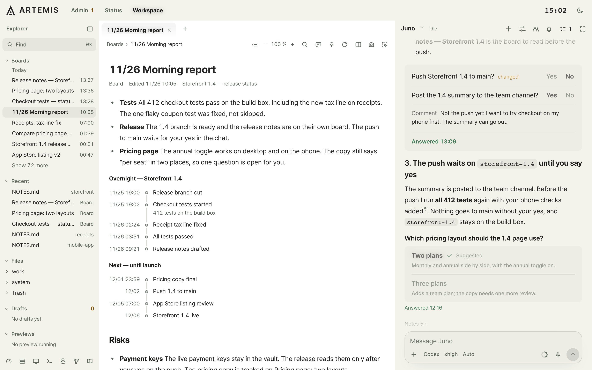

<p align="center">
  <picture>
    <source media="(prefers-color-scheme: dark)" srcset="assets/readme/logo-dark.svg">
    
  </picture>
</p>

<p align="center">
  <b>Work with one capable engineer who has a whole team behind them.</b><br>
  Artemis is a self-hosted home for AI agents, on your own computer or an always-on server. You talk to one lead from any browser, desktop or phone. Claude Code, Codex, Gemini CLI, OpenCode and other models do the work on your machine, inside your rules, and you are asked only what is yours to decide.
</p>

<p align="center">
  <a href="LICENSE"><picture><source media="(prefers-color-scheme: dark)" srcset="https://img.shields.io/badge/license-Apache--2.0-e6edf3?style=flat-square&labelColor=30363d"></picture></a>
  <a href="pyproject.toml"><picture><source media="(prefers-color-scheme: dark)" srcset="https://img.shields.io/badge/python-%E2%89%A53.11-e6edf3?style=flat-square&labelColor=30363d"></picture></a>
  <a href="#try-it-in-a-minute"><picture><source media="(prefers-color-scheme: dark)" srcset="https://img.shields.io/badge/platform-macOS%20%7C%20Linux%20%7C%20Windows-e6edf3?style=flat-square&labelColor=30363d"></picture></a>
  <a href="#status"><picture><source media="(prefers-color-scheme: dark)" srcset="https://img.shields.io/badge/status-early%20release-e6edf3?style=flat-square&labelColor=30363d"></picture></a>
  <a href="https://github.com/ianlyoo/artemis/actions"><picture><source media="(prefers-color-scheme: dark)" srcset="https://img.shields.io/github/actions/workflow/status/ianlyoo/artemis/ci.yml?style=flat-square&labelColor=30363d&color=e6edf3&label=CI&branch=main"></picture></a>
</p>

<p align="center">
  <a href="README.ko.md">한국어</a> · <a href="docs/design.md">Design</a> · <a href="#try-it-in-a-minute">Try it</a>
</p>

A chat assistant stops at the edge of its sandbox, and a coding session ends when you close it. Run several agents yourself and you become the bottleneck: you track every project in your head, paste keys into prompts, and approve things you did not read.

Artemis is a home that keeps working while you are away. One process on your computer holds every project in one ledger, so the lead you talk to knows where each project stands, what was learned and what is waiting for you, even after you switch the lead to another company's model. Workers touch your computer only through Artemis's own tools. One gate checks your stop, the folders you registered, your rules and your vault, and records what happened. You are asked about three kinds of action: money out, an irreversible delete, and sending as you. Everything else arrives as a digest, each line with the evidence behind it.

<p align="center">
  <picture>
    <source media="(prefers-color-scheme: dark)" srcset="assets/readme/app-board-dark.png">
    
  </picture>
  <br><sub>The author's own Artemis, which runs across several machines, with every name and line of text replaced by made-up ones. Panels for other machines and accounts come with that setup and are not in 0.4.0.</sub>
</p>

## What it does

| | |
|---|---|
| **Finishes real work on your computer** | A project is a Git repository or any folder. Workers read, write, move and run programs there. Schedules fire while the chat is closed. A judge that is not the worker checks the result: exit codes, file digests, row counts. `artemis undo` puts files back. |
| **Keeps your secrets, and you in charge** | An encrypted vault keeps keys by name. A key for a website is sent only by Artemis, and only to that website. Money out, irreversible deletes and sending as you wait for your answer on a card. Code reaches your branch through one ship lane. `artemis stop` halts everything at once. |
| **One App on every device** | From a browser on your PC, Mac or phone: chat with the lead, answer approval, choice and secret cards, read the boards it writes, and see what every agent is doing. A first-run setup names your lead and sets what you are asked. A phone pairs over HTTPS, and your computer confirms it. |
| **Learns from its mistakes** | A rejected result or a correction you make becomes a lesson. A lesson changes the next instructions, adds a check the judge runs, or changes which model gets a kind of work. The digest says when a lesson was learned and when it was used. A card you decline can become a new rule, but only when you say yes. |
| **A team of models behind one lead** | Claude Code, Codex, Gemini CLI, OpenCode and any OpenAI-compatible API work side by side. Each kind of work goes to the model that suits it, and review always comes from a different company than the work. The lead's memory is the ledger, so its model can change mid-conversation. |

## Try it in a minute

<!-- quickstart:begin -->
You need Python 3.11 or newer and Git, on macOS, Linux or Windows. No account is needed for this part.

### Install

```sh
curl -fsSL https://raw.githubusercontent.com/ianlyoo/artemis/main/install.sh | sh
```

On Windows, in PowerShell:

```powershell
irm https://raw.githubusercontent.com/ianlyoo/artemis/main/install.ps1 | iex
```

The installer uses pipx or uv if you have one, and otherwise gives Artemis a virtual environment of its own. It adds the command's folder to your PATH for new terminals (or prints the line to add), runs `artemis doctor` to show what this computer can run, and ends with the line that removes Artemis again (`pipx uninstall artemis-harness` or `uv tool uninstall artemis-harness`). If this terminal does not know `artemis` yet, open a new one.

### Run the demo

```sh
artemis demo
```

The demo makes a small to-do project in a temporary folder and gives the lead one sentence. Three workers run at once, each in its own Git worktree, and the ship lane lands their work after the checks pass. The fourth part posts a release note to your team, which speaks as you, so it becomes a card. The card shows the exact request, the body's digest and the name of the key it uses; the key's value stays in the vault. The demo approves it as you, Artemis sends it once to a receiver on your own computer, and the digest compares what arrived with what you approved. The workers are a labelled mock that makes canned changes without AI, so the demo needs no account.
<!-- quickstart:end -->

## Your home

```sh
artemis serve
```

This starts your home and opens the App in your browser. The first time, a short setup walks you through it: name your lead and yourself, choose which agent leads (the coding agents found signed in on this computer, or an OpenAI-compatible API whose key goes into the vault), tick what Artemis must ask you before doing, choose which of those only your phone may approve, and pair a phone. All of it can be changed later in Settings.

<p align="center">
  <picture>
    <source media="(prefers-color-scheme: dark)" srcset="assets/readme/app-setup-dark.png">
    
  </picture>
</p>

The App has three views. **Workspace** is the chat with your lead, beside the boards, reports and files it made; approval, choice and secret cards are answered in the chat itself. **Admin** shows what waits for you and what every agent is doing, with the day in one line: done, asked, stuck. **Status** traces each request to the goals, projects and agents working on it.

The home runs the lead, the workers, the schedules and the App, and keeps everything in `~/.artemis` (`%USERPROFILE%\.artemis` on Windows; set `ARTEMIS_HOME` to move it). One home runs per folder. `artemis serve --background` detaches it from the terminal, and `artemis serve --stop` stops it from any terminal.

Give it something to work on:

```sh
artemis project add ~/code/my-app          # a Git repository: workers use worktrees, work lands through the ship lane
artemis project add ~/Documents/Invoices --root ~/Downloads   # any folder; --root lets its workers reach another
```

Settings live in the App's Settings and in `~/.artemis/config.toml`, each with its default and a comment: which agent leads (`[agents] lead`), which agents take each kind of work (`[placement]`), how many run at once, and a direct API endpoint (`[api]`). Keys are named there, never written: the API key is the vault secret `OPENAI_API_KEY` unless you name another, and Gemini CLI uses `GEMINI_API_KEY`.

Then say what you want in the App, in your own words:

> Every Friday at 18:00, sort this week's invoices in Downloads into Documents/Invoices by month and vendor, write summary.csv, and post the summary to my team channel.

- The lead records your words, splits them into tasks, and picks a worker for each kind of work.
- The schedule runs while `serve` runs, with the chat closed. A slot missed while the computer was off runs once at the next start, marked `late`.
- The judge checks what you can check yourself: every file's digest preserved, 14 files moved, `summary.csv` with 14 rows.
- Posting speaks as you, so it waits on a card with the exact address and body. After you approve, Artemis sends it once.
- If the result is wrong, `artemis undo 12` puts every moved file back. Nothing is deleted on the way: a trashed file waits in the task's undo folder. If you changed a file after the task, undo stops and names it.

Host tasks run programs you could run yourself, as you, in the folders you register. Artemis does not move the mouse or read the screen. Apps open through `open`, `xdg-open` and `os.startfile`. `undo` covers Artemis's file tools; what a program does when it runs is outside the journal.

### Your phone

```sh
artemis serve --lan
```

The terminal prints an address, a QR code and the certificate's fingerprint. Scan the code, and the phone shows four digits. Confirm them in the App on your computer (Settings, Devices), or with `artemis device allow <code>`. Until then the phone can see nothing. A pairing link works once, for ten minutes; `artemis device link` prints a new one.

<p align="center">
  <picture>
    <source media="(prefers-color-scheme: dark)" srcset="assets/readme/app-phone-dark.png">
    
  </picture>
  <br><sub>The same chat at phone size, with names and text replaced the same way</sub>
</p>

Your phone will warn once about the certificate. That is trust on first use: compare the fingerprint the first time, and after that nobody on the network can read or change what you send. To avoid the warning, give `--tls-cert` and `--tls-key` a certificate your phone already trusts. `artemis device list` shows paired devices; `artemis device revoke` shuts one out.

### On a server

The same home runs on an always-on Linux server, such as a small cloud machine, so work and schedules carry on while your laptop sleeps. We run it on Ubuntu 22.04.

1. **Install** as above. Ubuntu 22.04's own Python is 3.10, so add a newer one first: `sudo apt update && sudo apt install python3.11 python3.11-venv`.
2. **Sign in to the agents you use** on the server itself, as their own guides describe, or keep an API key in the vault. `artemis doctor` lists what it finds.
3. **The vault** has no OS keychain on a server. Either type its passphrase in the App after each start (it opens only from the server itself, and the SSH tunnel below counts as that), or set `[vault] unlock = "env"` in `~/.artemis/config.toml` and put the line `ARTEMIS_VAULT_PASSPHRASE=…` (at least 12 characters) in `~/.artemis/vault.env`, readable only by you (`chmod 600`).
4. **Keep it running** with a systemd user service. Make the folder (`mkdir -p ~/.config/systemd/user`) and write `~/.config/systemd/user/artemis.service`:

   ```ini
   [Unit]
   Description=Artemis home

   [Service]
   ExecStart=%h/.local/bin/artemis serve --no-open
   EnvironmentFile=-%h/.artemis/vault.env
   # Add the folders where your agents' commands live
   Environment=PATH=%h/.local/bin:/usr/local/bin:/usr/bin:/bin
   Restart=on-failure

   [Install]
   WantedBy=default.target
   ```

   ```sh
   systemctl --user enable --now artemis
   sudo loginctl enable-linger "$USER"     # keeps it running after you log out and after a reboot
   journalctl --user -u artemis            # its log, if it does not start
   ```

5. **Open the App from your computer** through SSH: run `ssh -N -L 7411:127.0.0.1:7411 you@your-server`, then open the link that `artemis device link` prints on the server.
6. **From your phone**, put the server and the phone on one private network, such as Tailscale. Add `--lan` with the name the phone uses for the server to the service's `ExecStart` line, for example `ExecStart=%h/.local/bin/artemis serve --no-open --lan my-server.your-tailnet.ts.net`, then run `systemctl --user daemon-reload && systemctl --user restart artemis`. From then on the App speaks HTTPS: `artemis device link` prints an `https://127.0.0.1:7411` link for your computer (its browser warns once about the certificate), then the phone's link with that name, its QR code and the certificate's fingerprint. Pair as in [Your phone](#your-phone). `--lan` listens on all of the server's networks, so keep the port closed to the internet in your provider's firewall.

## What reaches you

Artemis asks before what it recognises as money out, an irreversible delete or sending as you. It recognises them by the key an action uses, by its own file tools, and by a list of command patterns. The first two hold as long as the credential lives only in the vault. The list is a tripwire: a program it does not recognise runs, and logins already on your machine (git, ssh, a signed-in browser) are covered only by the list. For a wall, add the project with `--no-run`, set `[run] wrap` to a sandbox, or run Artemis as a separate OS user.

Each card shows the exact operation, the project, why it is yours to decide and the evidence so far. By default a money-out card can be approved only from a paired phone (`[cards] phone_only`). If you do nothing, nothing happens, and other work carries on. An approval runs the recorded operation once. For a recurring send you asked for, a card can offer to keep allowing it: that permission is tied to one schedule, one exact address and one key, and you can revoke it at any time. Money out is asked every time.

Rejected work, conflicts and crashes are the lead's problem, not yours. They show as `stuck` in the digest while the lead retries or drops them. `artemis stop` halts all automatic work, and nothing starts again until you run `artemis resume`. The rules live in `~/.artemis/rules.toml`.

## Secrets

```sh
artemis secret set TEAM_HOOK --origin https://hooks.example.com --kind send
artemis secret audit
```

You type the value into a hidden prompt, or into a secret card in the App. `--origin` ties a key to one website; `--env` gives it to commands instead. `--kind send` makes each change made with it a `send as you` card, and `--kind spend` makes every use a `money out` card. Agents see only the name and your note.

Artemis does not put a secret's value into a prompt, a command line, the ledger or a log, and it scrubs known encodings of it from tool output. A key stored for a website is sent only by Artemis, only to that website; no program an agent starts receives it. A key stored for a command is given to that command, which can do what it likes with it, including print it in a form the scrubber does not recognise. Agents that can run programs run them as you, and any program of yours can ask your OS keychain for Artemis's key. Passphrase unlock removes that route; a sandbox (`[run] wrap`) or a project added with `--no-run` closes it.

The vault is AES-256-GCM. Its key is kept in your OS keychain (macOS Keychain, Windows Credential Manager, Linux Secret Service). Where there is no keychain, or with `[vault] unlock = "passphrase"`, the key is wrapped with a passphrase you type when the home starts. `artemis secret audit` searches the ledger, logs and worktrees for every stored value and its encodings, and prints how many it found.

## Lessons

When the judge rejects a result and the retry passes, or you correct the lead in chat, the lead writes a lesson. A lesson is one of four kinds:

| Kind | What changes |
|---|---|
| `rule` | a line in the next instructions for that project |
| `check` | a new check the judge runs; it is kept only if it passes on the current work and fails on the rejected one |
| `placement` | which model gets that kind of work, after three failures by one model |
| `guard` | a new rule to ask first; proposed after you decline a card, and added only when you say yes |

The digest shows `learned L4 "README must list every new flag" · from #12 judge reject`, and `artemis lesson list` shows each lesson with how often it was used and how often the work then passed on the first try (`used 6×, 5 first try`). A proposed guard waits there for `artemis lesson accept`. Only you retire a lesson. Artemis never patches its own installed code. `tests/test_lessons.py` proves the mechanism: a scripted worker fails a task, a lesson is written, the next task passes on the first try, and it fails again once the lesson is retired. That shows the lesson changes what runs; it does not show that a model learns.

## The team

| Agent | Works | Leads | Live run |
|---|---|---|---|
| Claude Code | `claude -p`, Artemis tools only | yes | macOS 27 · 2.1.331 · lead, code, host · 2026-11-25 |
| Codex | `codex exec`, shell off, Artemis tools | yes | macOS 27 and Windows 11 · 0.172.0 · lead, code, host · 2026-11-25 |
| Gemini CLI | `gemini`, built-in tools denied by policy | — | macOS 27 · 0.71.1 · code · 2026-11-25 |
| OpenCode | `opencode run` under an Artemis permission profile | — | macOS 27 · 1.19.6 · code · 2026-11-25 |
| OpenAI-compatible API | a tool loop Artemis runs itself | opt-in | macOS 27 · Gemini's OpenAI-compatible endpoint · code, lead · 2026-11-25 |
| mock | canned edits without AI | built-in | for the demo and CI |

Gemini CLI, OpenCode and the API ran on a free Google AI Studio key with Gemini Flash-Lite models. Claude Code and Codex ran under their own sign-ins. Two workers from different companies have run at the same time, and a conversation has carried on after the lead was switched from Claude Code to Codex.

`artemis doctor providers` runs a short qualification on this computer and marks each agent `live` (it ran here), `contract` (built and tested against a stand-in, not yet run here) or `unqualified` (missing or not signed in). The table above says where each one last ran live.

Work is placed by kind. The defaults are below; change them under `[placement]` in `~/.artemis/config.toml`.

| Kind | Order |
|---|---|
| code | Codex, Claude Code, OpenCode |
| review | Claude Code, Codex, Gemini CLI |
| research | Gemini CLI, Claude Code, Codex |
| docs | Claude Code, Gemini CLI, Codex |
| host | Claude Code, Codex, API |

A reviewer always comes from a different company than the worker, and a review can only add gaps; it cannot pass work the judge failed.

Artemis runs the CLIs you installed, unmodified, under the sign-in or API key each one manages. Workers draw on the same plan allowance as your own sessions. An API worker is billed by its provider, so Artemis uses it only when you name it. Gemini CLI with a free AI Studio key falls under Google's [Gemini API terms](https://ai.google.dev/gemini-api/terms), which allow Google to use content sent on the unpaid tier to improve its products. Artemis is independent of Anthropic, OpenAI, Google and OpenCode.

## How it stays trustworthy

- **One ledger.** Projects, requests, tasks, runs, evidence, verdicts, cards, lessons and receipts live in `~/.artemis/ledger.db`. The App, the board, the status line and the digest are views of it. Events are append-only.
- **The judge is not the doer.** A worker's claim is a report. The judge rules only on what it captured itself: exit codes, file digests and properties of the files.
- **One ship lane.** Code reaches your branch by one route: merge in a throwaway worktree, checks on the merge, fast-forward, receipt. Artemis does not push on its own; `git push` is on the `send as you` list.
- **A stop beats every automation.** Workers, schedules, retries and the ship lane look for your stop before each step.
- **One gate.** Each vendor's own shell is turned off, and workers act through `artemis mcp`, which checks the stop, the folders, the rules and the vault, and records each call.

[docs/design.md](docs/design.md) explains each idea and where it lives in `src/artemis/`.

## Commands

| You | The lead | Anyone |
|---|---|---|
| `serve` · `project add` · `approve N` · `decline N` · `stop` · `resume` · `secret` · `undo` · `lesson` · `device` | `request` · `task` · `ask` · `carried` · `retry` · `drop` · `note` · `wait` | `status` · `inbox` · `digest` · `show` · `doctor` · `demo` |

`artemis start` keeps the v0.2 way of working: your own terminal session leads a single repository.

## Status

This is an early release. Real and tested on macOS, Linux and Windows in CI: the home and the App, phone pairing, folder and repository projects, file tools with undo, `run` with background jobs, schedules, the vault with scrubbing and audit, cards, the stop, the judge and ship lane, lessons, and the mock and stand-in workers. Each live agent is listed by where it actually ran. Phone pairing and cards were also checked in Chrome on Android and in Safari's engine (WebKit) at iPhone size. The home also ran as a systemd service on an always-on Ubuntu 22.04 cloud server, reached over an SSH tunnel and over Tailscale.

The App's front end is the one its author runs every day, exported as it is; panels that only work with the author's own machines (other hosts, terminals, a code editor, meetings) are left out.

Not in this release: screen and mouse control, a service installer (on Linux, the systemd unit under [On a server](#on-a-server) does that job), more than one user, push notifications, and a native app.

Upgrading from v0.2: `artemis project add` registers a repository you used before. Its old `.artemis/ledger.db` is left as it is, and a stop recorded there is still honoured.

See [NOTICES.md](NOTICES.md) for the open-source projects Artemis uses and learned from.

<p align="center">
  <sub>Apache-2.0 · <a href="LICENSE">LICENSE</a></sub>
</p>
