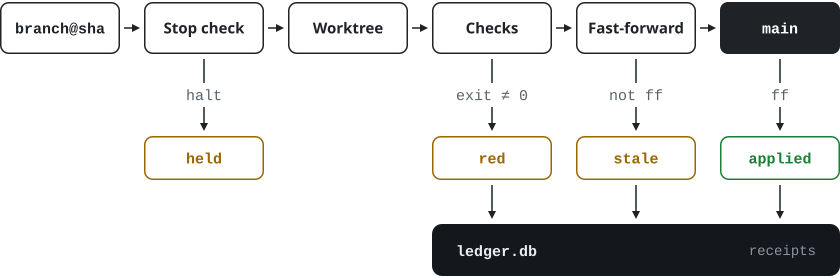

<p align="center">
  <picture>
    <source media="(prefers-color-scheme: dark)" srcset="assets/readme/wordmark-dark.svg">
    
  </picture>
</p>

<p align="center">
  <b>Multi-agent orchestration harness</b><br>
  Many agents, one ledger.<br>
  No one judges their own work.
</p>

<p align="center">
  <a href="LICENSE"><picture><source media="(prefers-color-scheme: dark)" srcset="https://img.shields.io/badge/license-Apache--2.0-e6edf3?style=flat-square&labelColor=30363d"></picture></a>
  <a href="pyproject.toml"><picture><source media="(prefers-color-scheme: dark)" srcset="https://img.shields.io/badge/python-%E2%89%A53.11-e6edf3?style=flat-square&labelColor=30363d"></picture></a>
  <a href="#see-it-run"><picture><source media="(prefers-color-scheme: dark)" srcset="https://img.shields.io/badge/platform-macOS%20%7C%20Linux-e6edf3?style=flat-square&labelColor=30363d"></picture></a>
  <a href="#status"><picture><source media="(prefers-color-scheme: dark)" srcset="https://img.shields.io/badge/status-showcase-e6edf3?style=flat-square&labelColor=30363d"></picture></a>
  <!-- badges:ci-release -->
</p>

<p align="center">
  <a href="README.ko.md">한국어</a> · <a href="docs/design.md">Design</a> · <a href="#see-it-run">Run the demo</a>
</p>

<p align="center">
  <picture>
    <source media="(max-width: 700px)" srcset="assets/readme/ledger-narrow.svg">
    <source media="(min-width: 768px) and (max-width: 1080px)" srcset="assets/readme/ledger-narrow.svg">
    
  </picture>
</p>

<p align="center">
  <sub>One invented task: the judge rejects the first claim for missing evidence, passes the second, and the ship lane leaves a receipt.<br>
  Rows from <a href="docs/demo/transcript.txt">docs/demo/transcript.txt</a>, drawn by <a href="assets/readme/render.py">assets/readme/render.py</a>.</sub>
</p>

When one person directs many AI agents, it soon becomes hard to tell what was decided, what was done, and what was actually checked.

Artemis is a harness that keeps those three apart. Every request, decision, claim and piece of evidence goes into one database, the ledger, and chat and dashboards only show what the ledger holds. A judge that did none of the work rules on each claimed completion, and every change reaches the main branch through one ship lane that leaves a receipt.

It is not a setup kit for one coding agent (skills and instruction files for a single session). It is the organisation around many agents: who decides, where the state lives, who checks the work, and how a change ships.

## Roles

<p align="center">
  <picture>
    <source media="(max-width: 700px)" srcset="assets/readme/roles-narrow.svg">
    <source media="(min-width: 768px) and (max-width: 1080px)" srcset="assets/readme/roles-narrow.svg">
    <source media="(prefers-color-scheme: dark)" srcset="assets/readme/roles-dark.svg">
    
  </picture>
</p>

Each agent holds one role with a written scope and hands a narrower piece of work to the next. The owner makes a request, the lead decides what and why, the CTO decides how, a PM runs one project and a worker does one task. Each writes its step into the ledger before handing on.

Outside this chain sits the judge, called the CQO in the code. It does none of the work. It reads each completion claim with its evidence and gives one of three verdicts: pass, reject with the gaps listed, or stop when it cannot rule.

Code: [roles.py](src/harness/roles.py) · [judge.py](src/harness/judge.py) · [ledger.py](src/harness/ledger.py)

## The ship lane

Whoever wrote a change, it reaches main by this one route.

<p align="center">
  <picture>
    <source media="(max-width: 700px)" srcset="assets/readme/ship-lane-narrow.svg">
    <source media="(min-width: 768px) and (max-width: 1080px)" srcset="assets/readme/ship-lane-narrow.svg">
    <source media="(prefers-color-scheme: dark)" srcset="assets/readme/ship-lane-dark.svg">
    
  </picture>
</p>

A branch enters pinned at one commit. While a stop set by a person is in force, nothing runs until a person lifts it. Otherwise the checks listed in `ship.toml` run in a disposable worktree. A failing check leaves main untouched and records a red receipt. When the checks pass, main is fast-forwarded and the receipt is marked applied; if main has moved on in the meantime, the receipt is marked stale and the change needs a new commit.

Code: [ship.py](src/harness/ship.py) · [test_ship.py](tests/test_ship.py)

## Principles

- **State lives in the ledger alone.** A chat reply, a dashboard or a file only displays ledger rows; a fact never written there is gone when the session ends.
- **The judge is not the doer.** Proof means a command kept with what it printed, or a thing that can be inspected directly. A claim without proof is marked "reported".
- **A stop set by a person beats every automation.** Timers, retries, queues and crash recovery look for it before acting, and only a person can clear it.
- **Three kinds of action need the owner's yes:** spending money, deleting what cannot be restored, and speaking in the owner's name. The rest goes ahead and is reported afterwards.
- **Procedures are read when needed.** A role carries a one-line pointer per procedure and opens the full text when that moment arrives. The demo's are in [examples/runbooks](examples/runbooks).
- **Repair the design, not the symptom.** When something fails, the part of the design that let it happen is changed. Nothing is bolted on at the spot where the failure surfaced.

[docs/design.md](docs/design.md) explains each idea and points to the module in `src/harness/` where it lives.

## See it run

The ledger at the top of this page is this run. It takes an invented task through the roles, the judge and the ship lane, against a local ledger that holds only made-up data. The full output is in [docs/demo/transcript.txt](docs/demo/transcript.txt).

You need Python 3.11 or newer and Git, on macOS or Linux.

<!-- quickstart:begin -->
You need Python 3.11 or newer, Git, and a POSIX shell. Run the quickstart from a normal shell outside Git hooks and other tools that set `GIT_DIR`.

### Install

Run these commands from your Artemis clone.

```sh
python3 -m venv .venv
. .venv/bin/activate
python -m pip install .
```

### Run a project

Keep the virtual environment active and run this block in an empty directory. It creates a fictional garden list in a new Git repository.

```sh
set -eu
mkdir garden-list
cd garden-list
git init -q -b main
git config user.name "Garden Example"
git config user.email garden-example
git config commit.gpgsign false
printf '.harness/\n' > .gitignore
harness init

printf 'print("basil")\n' > garden.py
git add .gitignore harness.toml garden.py
git commit -qm "Start a garden list"

request=$(harness request "Make the garden list readable by scripts")
goal=$(harness goal "$request" "Print the list as a JSON array")
harness plan "$goal" "Use the standard JSON library and check the output"
project=$(harness project "$goal" "Garden list")
task=$(harness assign "$project" "Print JSON" \
  --criterion 'Source=file:garden.py' --criterion 'JSON output=cmd:python check.py')
approval=$(harness request-action --task "$task" --kind 'send as owner' "Publish a sample note")

git switch -qc json-list
cat > garden.py <<'EOF'
import json

print(json.dumps(["basil"]))
EOF
cat > check.py <<'EOF'
import json
import subprocess
import sys

output = subprocess.check_output([sys.executable, "garden.py"], text=True)
assert json.loads(output) == ["basil"]
print("JSON check passed")
EOF
git add garden.py check.py
git commit -qm "Print the list as JSON"
commit=$(git rev-parse HEAD)

harness stop "Pause before submitting"
if harness submit --task "$task" --commit "$commit" --claim "Ready"; then exit 1; else test "$?" -eq 1; fi
harness resume "Continue the example"

harness submit --task "$task" --commit "$commit" --claim "JSON is ready" --evidence 'file:garden.py'
if harness judge --task "$task"; then exit 1; else test "$?" -eq 3; fi
harness submit --task "$task" --commit "$commit" --claim "JSON check recorded" \
  --evidence 'file:garden.py' --evidence 'cmd:python check.py'
harness judge --task "$task"

git switch -q main
harness ship --task "$task" --branch json-list
test "$(git rev-parse main)" = "$commit"
if harness action --approval "$approval"; then exit 1; else test "$?" -eq 1; fi
harness approve --approval "$approval"
harness action --approval "$approval"
harness show --task "$task"
```

You should see a blocked submission while stopped, a rejection for missing command evidence, then a pass and a ship receipt. The note waits for approval and is simulated after approval. The timeline and receipts live in `garden-list/.harness/ledger.db`. Run `harness show` again from the garden project to read them.

For your own repository, run `harness init` at its root and edit `harness.toml` to set `ship.checks` and the role runbook paths. Keep `.harness/` out of Git and check out a clean `main` before shipping. The checked-out `harness.toml` on `main` selects the checks for the pinned candidate. The evidence and check commands run locally in disposable Git worktrees with your process permissions. Use commands and commits you trust. Each command selects its role, so a local operator can act in every role.

To connect a local worker, uncomment `run` under `[roles.worker]` and set its command. `harness run --task N --commit SHA` passes the runbook, task number, commit and criteria on stdin. It records stdout as the claim. Supply `--evidence` to capture proof separately. `harness runbook worker` prints the configured instructions.

Commands exit with 0 on success, 1 for a workflow or local operation error, and 2 for invalid command syntax. Judgment returns 3 for rejection or 4 for a stop. Shipping returns 5 if checks fail or the candidate diverges from `main`.
<!-- quickstart:end -->

## Status

This repository is a showcase: the design, and a local demo in which scripted roles stand in for live agents. When a step needs a person, the system waits. The demo runs on macOS and Linux; Windows is not supported yet, and an installable release is not out yet.

See [NOTICES.md](NOTICES.md) for the open-source projects that informed this showcase.

<p align="center">
  <sub>Apache-2.0 · <a href="LICENSE">LICENSE</a></sub>
</p>
