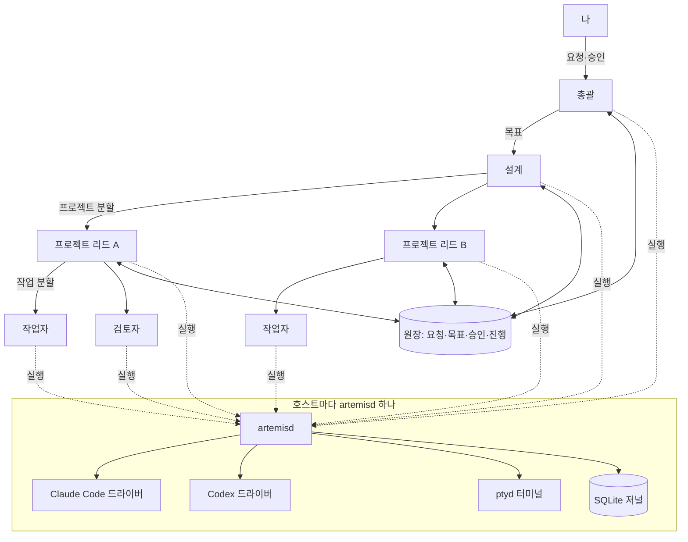

# Artemis · Claude Code·Codex 멀티 에이전트 엔진

**English abstract.** Artemis is a self-hosted agent engine: one daemon per host (`artemisd`) runs the official Claude Code (Agent SDK) and Codex (`codex app-server`) CLIs as supervised child processes, journals every turn to SQLite, gates every tool call through a default-deny policy core, and keeps terminals alive in a separate PTY sidecar. It powers my multi-agent system: an orchestrator turns my requests into goals, a planner designs them into projects, project leads split those into tasks, and workers and reviewers carry them out, all coordinated through a shared ledger. The engine grew out of running that system on [Paseo](https://github.com/getpaseo/paseo) and was rebuilt as an independent engine for crash recovery, policy and process control I needed.

## 무엇을 만들었나

여러 AI 코딩 에이전트에 역할을 나눠 맡기는 개인 시스템을 Paseo 위에서 운영하다가, 그 경험을 바탕으로 필요한 부분을 직접 다시 만든 독립 엔진이다. 공식 CLI를 감싸서 쓰기 때문에 각 CLI의 로그인·요금제·업데이트를 그대로 따르고, 엔진은 그 위에서 **수명 주기·기록·권한·터미널**만 책임진다.

- **호스트당 데몬 하나(`artemisd`).** 에이전트 생성·메시지·중단·되감기·보관을 HTTP/WebSocket API와 CLI(`artemis`)로 다룬다.
- **드라이버.** `drivers/claude`는 Claude Agent SDK, `drivers/codex`는 `codex app-server` JSON-RPC, `drivers/agy`는 Antigravity CLI를 같은 계약(`core/types.ts`)으로 맞춘다.
- **저널.** 모든 이벤트를 SQLite에 순서 커서(`epoch`, `seq`)로 남긴다. 데몬이 죽어도 재시작 시 대기 중인 메시지와 턴 상태를 복구하고, 에이전트는 원래 스레드를 이어서 연다.
- **정책 코어.** 셸·파일·MCP 도구 호출을 모두 한 게이트에 통과시킨다. 프로필이 허락하지 않은 도구는 기본 거부하고, 사람의 승인이 필요한 행동은 승인 기록을 한 번만 소비한다(compare-and-set).
- **프로세스 관리.** 에이전트가 띄운 모든 하위 프로세스를 pid·시작 시각으로 추적하고, 중단 시 INT → TERM → KILL 순서로 정리한 뒤 남은 프로세스가 없는지 확인한다(Linux·macOS).
- **터미널 사이드카(`ptyd`).** PTY와 headless 화면을 별도 프로세스가 소유한다. 데몬이 재시작해도 터미널은 살아 있고, 느린 클라이언트만 끊어서 다른 터미널의 출력은 막히지 않는다.
- **에이전트용 MCP.** 에이전트가 다른 에이전트를 만들고 지시하는 도구(`create_agent`, `send_agent_prompt` 등)를 MCP로 제공한다. 이 도구들 위에 총괄·리드·작업자 구조를 올린다.
- **플러그인 경계.** 배포마다 다른 부분(승인 화면, 역할별 프로필, 원장 연동)은 `--plugin <module>` 하나로 붙인다. 플러그인 없이도 엔진은 혼자 돈다.

## Artemis 시스템 구조



- **총괄(Orchestrator):** 내 요청을 받아 목표로 정리하고, 결과를 모아 보고한다. 돈·공개·되돌릴 수 없는 일은 내 승인을 받는다.
- **설계(Planner):** 목표를 프로젝트로 설계하고 모델·권한·완료 기준을 정해 리드를 띄운다.
- **프로젝트 리드(Project lead):** 프로젝트 하나를 끝까지 맡아 겹치지 않는 작업으로 나누고 작업자를 띄워 통합한다.
- **작업자(Worker)·검토자(Reviewer):** 작업 하나를 받아 구현·실험하고 정해진 형식으로 보고한다. 되돌릴 수 없는 변경만 검토자가 따로 본다. 작업 성격에 따라 Claude나 Codex 모델을 고른다.
- **원장(Ledger)·콘솔(Console):** 요청·목표·승인·진행을 원장 한곳에 두고 모든 역할이 이를 기준으로 움직인다. 나는 콘솔에서 승인하고 대화한다.

이 저장소는 엔진만 담는다. 원장, 콘솔, 내 배포용 플러그인과 운영 규칙은 개인 정보와 계정 설정이 섞여 있어 **공개하지 않는다**(구조만 위에 설명했다).

## 실행

Node.js 24 이상(검증 버전 24.22.0)과 npm이 필요하다. TypeScript를 Node의 type stripping으로 바로 실행하므로 빌드 단계가 없다. Linux가 주 시험 환경이고 macOS도 지원한다. `node-pty`는 플랫폼에 따라 컴파일러가 필요할 수 있다.

```bash
npm ci
npm run typecheck
npm test     # 실제 CLI 로그인·외부 네트워크 없이 도는 시험 148개 (실제 CLI 시험 3개는 건너뜀)
```

데몬 실행과 상태 확인:

```bash
npm run artemisd -- --state /tmp/artemis-state --api-port 47160 --mcp-port 47161 --init-tokens
sh cli/artemis --state /tmp/artemis-state doctor
```

- `--init-tokens`는 API·CLI 토큰 파일을 0600 권한으로 만들고, DB에는 SHA-256만 저장한다.
- 플러그인 없이 시작하면 기본 `generic` 프로필이라 에이전트에게 MCP 도구를 하나도 주지 않는다. 역할별 프로필·승인 화면·원장 연동은 `--plugin /절대/경로/plugin.mjs`로 붙인다(`core/types.ts`, `core/plugin.ts`). 플러그인은 신뢰하는 코드로 취급한다.
- 실제 에이전트를 돌리려면 `claude`와 `codex`(검증한 프로토콜 0.164.0) CLI를 따로 설치하고 로그인해야 한다. 엔진 시작 자체에는 필요 없다.
- 실제 CLI로 도는 시험은 `ARTEMIS_REAL=1 npm test`로 켠다. 사용량 요금이 생길 수 있어 기본으로는 꺼져 있다.
- 정책 검사는 휴리스틱이지 OS 샌드박스가 아니다. 승인 경계는 `core/policy/README.md`와 `drivers/codex/GATE-COVERAGE.md`에 적었다.

## 저장소 구성

| 경로 | 내용 |
|---|---|
| `core/` | 데몬 본체: API, 저널, 정책, MCP, 터미널 서비스, 프로세스 관리 |
| `drivers/` | Claude·Codex·Antigravity 드라이버와 Codex 프로토콜 타입 |
| `ptyd/` | 터미널 사이드카 |
| `cli/` | `artemis` 명령 |
| `scripts/` | 시험 실행기 |
| `LICENSES/`, `THIRD_PARTY_NOTICES.md` | Codex 프로토콜(Apache-2.0)과 npm 의존성의 라이선스 고지 |

## 출처와 권리

Artemis는 [Paseo](https://github.com/getpaseo/paseo)(Apache-2.0, © Mohamed Boudra)로 에이전트 시스템을 운영하며 얻은 설계 경험을 바탕으로 만들었다. Paseo의 코드는 가져오지 않았고 엔진 코드는 새로 작성했다. `drivers/codex/protocol/`의 타입은 [OpenAI Codex](https://github.com/openai/codex)(Apache-2.0)의 `codex app-server generate-ts`로 생성했다. 상세는 [THIRD_PARTY_NOTICES.md](THIRD_PARTY_NOTICES.md)에 있다. Claude Agent SDK는 Anthropic의 자체 약관을 따르는 의존성으로 이 저장소에 포함하지 않으며, 각 사용자가 자기 계정으로 로그인해 쓴다. 프로젝트 코드는 [MIT](LICENSE)다.

구현은 Claude Code와 Codex 에이전트를 이 시스템으로 오케스트레이션해 진행했다. 설계 방향과 채택 결정은 내가 내렸고, 에이전트가 구현과 시험을 맡았다.
