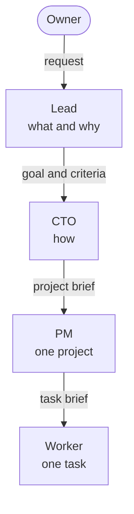
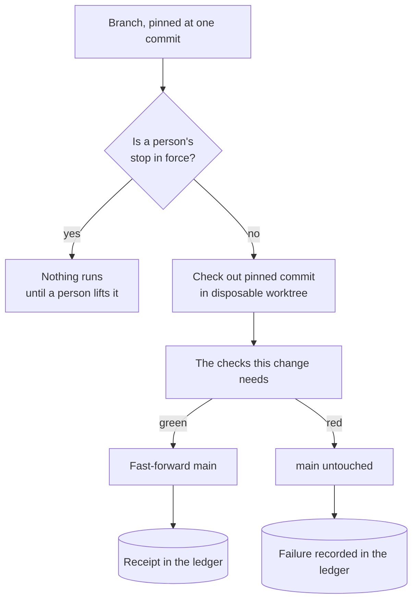
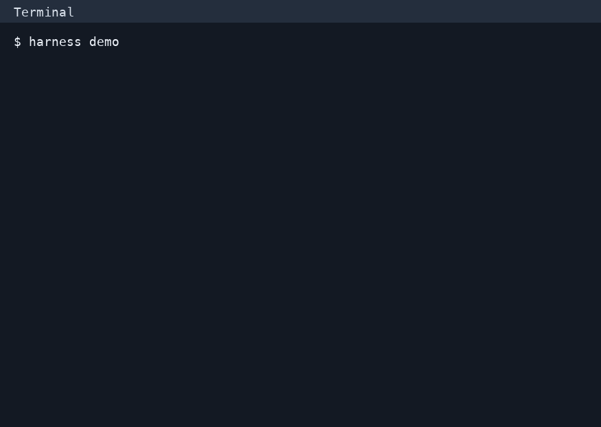

# Artemis

English · [한국어](README.ko.md)

When one person directs many AI agents, it soon becomes hard to tell what was decided, what was done, and what was actually checked.

Artemis is a harness that keeps those three apart. Each agent holds one role with a written scope and hands a narrower piece of work to the next. Every request, decision, claim and piece of evidence goes into one database, the ledger, and chat and dashboards only show what the ledger holds. A judge that did none of the work rules on each claimed completion, and every change reaches the main branch through one ship lane that leaves a receipt.

It is not a setup kit for one coding agent (skills and instruction files for a single session). It is the organisation around many agents: who decides, where the state lives, who checks the work, and how a change ships.

## Roles



Outside this chain sits the judge, called the CQO in the code. It does none of the work. It reads each completion claim with its evidence and gives one of three verdicts: pass, reject with the gaps listed, or stop when it cannot rule.

## One task, end to end

The demo records a fictional todo CLI change in SQLite.

1. The owner requests script-readable output. The lead records the goal, the CTO records the approach, and the PM assigns the JSON flag task.
2. The worker submits the commit and a file digest. The judge rejects the claim because the test result is missing.
3. The worker attaches the test command and its output to a new submission for the same commit. The judge passes it.
4. The ship lane checks that commit, fast-forwards main and records the receipt.

## The ship lane

Whoever wrote a change, it reaches main by this one route.



## Ideas

- **State lives in the ledger alone.** A chat reply, a dashboard or a file only displays ledger rows; a fact never written there is gone when the session ends.
- **One ship lane.** Every change is checked in a throwaway worktree and lands with a receipt, or does not land.
- **The judge is not the doer.** Proof means a command kept with what it printed, or a thing that can be inspected directly. A claim without proof is marked "reported".
- **A stop set by a person beats every automation.** Timers, retries, queues and crash recovery look for it before acting, and only a person can clear it.
- **Three kinds of action need the owner's yes:** spending money, deleting what cannot be restored, and speaking in the owner's name. The rest goes ahead and is reported afterwards.
- **Procedures are read when needed.** A role carries a one-line pointer per procedure and opens the full text when that moment arrives.
- **Repair the design, not the symptom.** When something fails, the part of the design that let it happen is changed. Nothing is bolted on at the spot where the failure surfaced.

## See it run



Full transcript: [docs/demo/transcript.txt](docs/demo/transcript.txt)

```sh
python3 -m venv .venv && . .venv/bin/activate && pip install -e . && harness demo
```

The demo runs an invented task through the roles, the judge and the ship lane, against a local ledger that holds only made-up data.

## Design

[docs/design.md](docs/design.md) explains each idea and points to the module in `src/harness/` where it lives.

## What is not here

This local demo uses scripted roles. When a step needs a person, the system waits.

## Status

This showcase includes the design and a runnable local demo.

See [NOTICES.md](NOTICES.md) for the open-source projects that informed this showcase.
